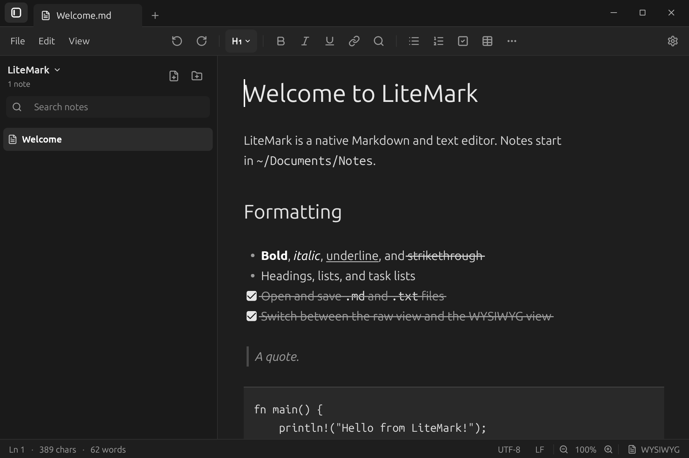
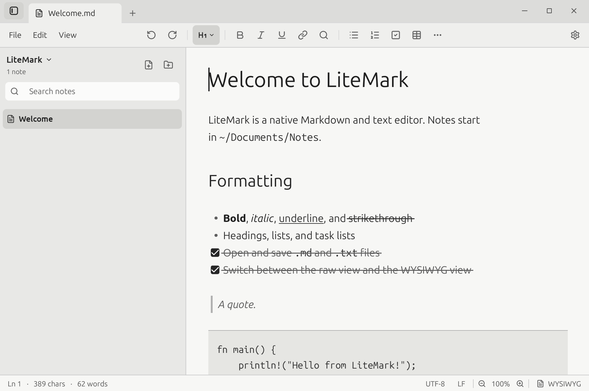

<h1 align="center">LiteMark</h1>

<p align="center">
  A fast, native Markdown and text editor with a raw view and a WYSIWYG view.<br>
  Offline by default. Your notes stay in a plain folder.
</p>

<p align="center">
  
  
</p>

> **Beta (0.x).** LiteMark works, but it has had little testing outside the author's machine. Keep backups of important notes and please [report bugs](https://github.com/Sira-pel/LiteMark/issues).

## Download

| Platform | Package |
| --- | --- |
| Windows (x64) | [LiteMark-windows-x64-setup.exe](https://github.com/Sira-pel/LiteMark/releases/latest/download/LiteMark-windows-x64-setup.exe) |
| macOS (Apple silicon) | [LiteMark-macos-arm64.dmg](https://github.com/Sira-pel/LiteMark/releases/latest/download/LiteMark-macos-arm64.dmg) |
| macOS (Intel) | [LiteMark-macos-x64.dmg](https://github.com/Sira-pel/LiteMark/releases/latest/download/LiteMark-macos-x64.dmg) |
| Linux (Debian/Ubuntu) | [litemark_amd64.deb](https://github.com/Sira-pel/LiteMark/releases/latest/download/litemark_amd64.deb) |

All versions are on the [Releases page](https://github.com/Sira-pel/LiteMark/releases).

<details>
<summary>Installation notes</summary>

- **Windows:** run the installer. It installs for your user by default. It is not code-signed, so SmartScreen may warn: choose "More info", then "Run anyway".
- **macOS:** open the `.dmg` and drag LiteMark to Applications. The app is not notarized, so the first time, right-click it and choose Open.
- **Linux:** `sudo apt install ./litemark_amd64.deb`. To update, install the newer package the same way. Your notes and settings are kept. Open and save dialogs need `xdg-desktop-portal` with a GTK or GNOME backend.

Windows and macOS builds are produced by CI and have had little hands-on testing.

</details>

## Features

- **Two views of one document:** raw Markdown or WYSIWYG, with optional line numbers in raw view.
- **Rich formatting:** headings, bold, italic, underline, strikethrough, links, lists, task lists, quotes, inline code, code blocks and tables.
- **Notes sidebar:** create, rename, move and trash notes and folders. Notes live in `~/Documents/Notes` by default.
- **Find and replace** with match case.
- **Files:** open `.md`, `.txt` and `.pdf` (as extracted text). Export to HTML, Markdown or plain text.
- **Safe saving:** writes go to a temporary file and are renamed into place.
- **Comfortable to use:** tabs, undo and redo, zoom, word wrap, dark / light / system theme and zen mode.

## Privacy

LiteMark works offline. Its only network request is an optional update check against the GitHub Releases API, at most once every 24 hours. No notes, settings or identifiers are sent, and nothing is downloaded automatically. Turn it off under the gear menu ("Check for updates") or with `"check_for_updates": false` in `settings.json`.

## Keyboard shortcuts

Press **F1** in the app for the full list. Common ones:

| Shortcut | Action |
| --- | --- |
| Ctrl+N / Ctrl+T | New note / new tab |
| Ctrl+O / Ctrl+S | Open / save |
| Ctrl+F / Ctrl+H | Find / find and replace |
| Ctrl+B / I / U | Bold / italic / underline |
| Ctrl+Shift+M | Toggle raw and WYSIWYG |
| Ctrl+\ | Toggle the sidebar |
| F11 | Zen mode |

<details>
<summary>All shortcuts</summary>

| Shortcut | Action |
| --- | --- |
| Ctrl+N | New note |
| Ctrl+Shift+N | New folder |
| Ctrl+T | New tab |
| Ctrl+O | Open a file |
| Ctrl+S | Save |
| Ctrl+Shift+S | Save as |
| Ctrl+W | Close the active tab |
| Ctrl+F | Find |
| Ctrl+H | Find and replace |
| Ctrl+B / I / U | Bold / italic / underline |
| Ctrl+Shift+X | Strikethrough |
| Ctrl+1 / 2 / 3 | Heading 1 / 2 / 3 |
| Ctrl+E | Inline code |
| Ctrl+K | Insert a link |
| Ctrl+Shift+C | Code block |
| Ctrl+Shift+M | Toggle raw and WYSIWYG |
| Ctrl+Shift+L | Toggle line numbers (raw view) |
| Ctrl+Z | Undo |
| Ctrl+Y or Ctrl+Shift+Z | Redo |
| Ctrl+\ | Toggle the notes sidebar |
| Delete | Move the selected note or folder to the Trash (sidebar focused; asks first) |
| Ctrl+Backspace / Ctrl+Delete | Delete word left / right (editor) |
| Ctrl+= / Ctrl+- / Ctrl+0 | Zoom in / out / reset |
| F1 | Shortcuts |
| F11 | Zen mode |
| Escape | Leave zen mode, or close a dialog |

On macOS, Cmd replaces Ctrl.

</details>

## Known limitations

- PDF export is not implemented, and opening a PDF shows extracted text only.
- Windows and macOS builds are not code-signed or notarized.
- Updates are not installed automatically; the app only tells you when a new release is out.

## Building

See [docs/DEVELOPMENT.md](docs/DEVELOPMENT.md) for building from source, packaging and releasing. In short, with Rust 1.85+:

```bash
cargo run --release
```

## License

MIT. See [LICENSE](LICENSE). Bundled fonts and dependencies keep their own licenses; see [THIRD_PARTY_NOTICES.md](THIRD_PARTY_NOTICES.md).
