# LiteMark Post-Milestone-6 Refined Plan (Milestones 7–10)

**Baseline Branch**: `perf/milestone-6` (commit `7a70c99`, stacked on PRs #100–#104 / Milestones 1–5)  
**Verification Scope**: Audited directly against the `perf/milestone-6` (`7a70c99`) codebase. Unproven root-cause claims, broken optimizations, already-fixed items, and previously rejected changes from the initial draft have been removed or gated behind profiling.

---

## Executive Summary & Verified Baseline

Across Milestones 1–6 (PRs #100–#104 and `perf/milestone-6`), LiteMark landed:
- **Milestone 1 (#100) & Milestone 2 (#101)**: Animated GIF `ElementId` panic fixes, tall-picture scroll margins, caret traps, heading `visible_line_end`, wrapped `sub_map` clamping, `link_stack` URL preservation, and CRLF navigation.
- **Milestone 3 (#102)**: 64 MiB LRU downscaling [`NoteImageCache`](src/ui/note_images.rs#L350-L385), `content_snapshot` removal, 24 B [`LineKind`](src/markdown/parser.rs#L363-L390), and index-based [`SidebarTreeItem`](src/ui/sidebar.rs#L140-L152).
- **Milestone 4 (#103)**: `partition_point` binary searches, streaming `push_wrapped`, incremental Find patching, parallel Quick Open content search, and background saves / `>1 MB` reads.
- **Milestone 5 (#104)**: [`HeightEstimates`](src/ui/text_editor.rs#L258-L325) running sums, Raw-mode row patching, 16-line parse checkpoints, and multi-threaded tail shifting.
- **Milestone 6 (`perf/milestone-6`, `7a70c99`)**: `Box<[T]>` per-line vectors, [`Option<Box<LineInline>>`](src/markdown/parser.rs#L785-L795) (`ParsedLine` 160 B → 80 B), on-demand `offset_map` (`804763e`), smaller [`PaintRow`](src/ui/text_editor.rs#L53-L68) (88 B → 64 B), and dependency `opt-level = "z"` (`15.93 MB` → `14.64 MB`).

### Verified Target Matrix

| Metric (3.1 MB / 120k-line Dense Note, unless noted) | After Milestone 6 (`7a70c99`) | Refined Target | Notes |
|---|---|---|---|
| **WYSIWYG 100k Idle Redraw** | `16.5–16.7 ms` (+20% M6 regression) | **`<= 13.8 ms`** (M7) / **`< 1 ms`** (if M10 virtualization needed) | M7 fixes the `+2.8 ms` off-screen `slice_bounds` regression; M10 virtualization is gated on profiling. |
| **Keystroke-to-Paint Frame Count** | `2` full frames/keystroke (`follow_caret`) | **`1` frame/keystroke** (M7) | Eliminates redundant `request_animation_frame()` when scroll offset does not change. |
| **Mouse-Move CPU in Note with Table** | Scans all `paint.rows` + allocs `Vec` per move | **`O(1)` bbox guard (`0` allocs)** (M7) | `occupied_content` only runs when pointer is near a visible table pill. |
| **Initial Note Open (12.7 MB / Multi-Tab Session)** | Sync all-tab read + 5 CPU passes + 3–5 `stat()` | **Active tab only, 1 background pass** (M9) | Lazy `deferred_load` for background tabs + fused stats/hash. |
| **Session Restore + 3.2 MB CLI Note Peak RAM** | **Bimodal: `984–1,127 MB` (8/17 runs)** | **Profiled + tab-switch/outline fixed** (M7) | M7 fixes real tab-switch overlap & outline virtualization, and profiles the ~700–800 MB bimodal gap. |
| **`ParsedDocument` Heap (3.1 MB Dense Note)** | `32.7 MiB` | **`~17.4 MiB`** (−47%, **gated M10**) | Realistic safe `u32` compaction (no `u16` overflow, no A3, no plain-segment removal). |
| **Release Binary Size (`litemark.exe`)** | `14.64 MB` | **`~13.0–13.5 MB`** (M9) | Deflate-compressed TTFs (~1.1–1.4 MB) + optional `rustls-native-certs` (~300 KB). |

---

## Part 0: Status of the Two Open Milestone 6 Mysteries ([`docs/m6-perf-plan.md`](docs/m6-perf-plan.md#L178-L194))

### Mystery 1: WYSIWYG 100k Idle Redraw +20% (+2.8 ms) Regression — Confirmed & Solved
- **Root Cause**: [`src/ui/text_editor.rs:3337`](src/ui/text_editor.rs#L3337) calls [`parsed_line.slice_bounds(d_start..d_end)`](src/markdown/parser.rs#L930-L939) **before** the viewport culling check at [`src/ui/text_editor.rs:3348`](src/ui/text_editor.rs#L3348).
- In [`bench_large_note_redraw`](src/viewport_culling_tests.rs#L475-L482), all 100,000 lines contain `**bold**` and wrap into 2 visual rows (`single_row == false`). After Milestone 6 commit `804763e` removed the cached `offset_map`, every off-screen line's first sub-row calls `offset_map_cached()`, chases `Box<LineInline>`, allocates a temporary `Vec` in `RowOffsetMap::from_hidden_ranges`, computes one byte index, and immediately drops the `Vec` — 100,000 allocs + frees per frame.
- **Fix**: Compute `slice_bounds` / `display_to_source` / `source_to_display` directly from `(self.source.start, self.source.end, self.prefix_end(), &self.hidden_ranges)` with zero heap allocations and no `Box<LineInline>` dereference.

### Mystery 2: Bimodal Startup/Tab-Switch Spike (`984–1,127 MB` vs `173–174 MB`) — Real Bugs Found, Full Root Cause Requires Profiling
- **Two real bugs verified in the codebase**:
  1. [`activate_tab`](src/app/commands.rs#L33-L44) calls `reset_editor_transient_state()`, which does **not** free the outgoing tab's `cached_parse` or call [`drop_painted_document_data()`](src/app/tabs.rs#L442-L449) (and does not clear `table_width_cache`) before switching `active_tab_id` and parsing the incoming tab via `snap_wysiwyg_table_delimiter()`, `ensure_cursor_formats()`, and `outline_element()`.
  2. Expanded [`render_outline`](src/ui/outline.rs#L86-L191) renders `.children(rows)` inside `overflow_y_scroll()` without `uniform_list` virtualization.
- **Why these two bugs alone do not explain a `984–1,127 MB` bimodal startup spike**:
  - Full simultaneous overlap of the 12.7 MB note (`194 MiB`), 3.2 MB note (`47.8 MiB`), and base app (`115 MB`) is only `~357 MB`, and [`docs/m6-perf-plan.md:108`](docs/m6-perf-plan.md#L108) already measured a real `14.7 MB + 3.6 MB` tab handoff settling at `191 MB` (`471 MB` peak working set).
  - Cold CLI launch (`LiteMarkApp::new` at [`src/app.rs:346-365, 714`](src/app.rs#L346-L365)) runs `restore_saved_tabs(true)` synchronously (no `start_big_read` race).
  - `outline_pinned` defaults to `false` ([`src/model/settings.rs:65, 119`](src/model/settings.rs#L65)), and the 12.7 MB session alone measured `267–279 MB`.
- **Plan**: Fix both real bugs in Milestone 7 **and** run a dedicated profiling pass (heap/ETW snapshots) on the `Saved session + 3.2 MB CLI note` scenario to isolate the remaining `~700–800 MB` bimodal spike before claiming it solved.

---

## Recommended Execution Roadmap (Milestones 7–10)

```mermaid
flowchart TD
    M6["Baseline: perf/milestone-6 (7a70c99)"]
    M7["Milestone 7: P0 Regressions, Active CPU/Battery & RAM Safety<br/>• Zero-alloc slice_bounds (fix +2.8ms M6 regression)<br/>• Fix 2x frame per keystroke in follow_caret()<br/>• Bbox-guard track_table_hover, stop 60Hz ImageSizeCache stat(), guard 5 cx.notify()<br/>• Free before alloc in activate_tab + uniform_list outline + profile 1GB spike<br/>• DiffEdit cost() fix, QuickOpen zero-clone, PaintRow Option<Arc>, P1.15"]
    M8["Milestone 8: Core WYSIWYG Editing Fidelity & Native Feel<br/>• Fix Ctrl+B start-of-word jump (W5) & toolbar boundary highlight (W6)<br/>• Editable Ctrl+K link URL + clipboard URL auto-paste (W7)<br/>• Auto-close ``` fences (W8) & guard CodeFence/HR Backspace/typing (W9)<br/>• WYSIWYG Ctrl+Arrow/Backspace (W10), list Tab nesting (W11), sequential OL (W12a)<br/>• WYSIWYG-aware handle_paste (W13), bounded span_group/Backspace undo (W14b/c), CRLF table (W15a)"]
    M9["Milestone 9: Startup Speed, Raw Mode, Incremental Outline & Safe Cuts<br/>• Lazy deferred_load tab restore + single-pass note stats/hash + BOM fix<br/>• Incremental outline_cache splice (keeping 40-tick minimap strip live)<br/>• Skip full AST parse in Raw mode + safe parser fast-paths (P1.1, P1.2, P1.6)<br/>• Deflate-compress embedded TTFs (-1.1–1.4 MB) + optional rustls-native-certs + zoom clamp"]
    M10["Milestone 10 (Gated on Post-M7/M9 Profiling): Heavy Refactors & Optional Parity<br/>• Scoped TableWidthCache cell wrap cache (general ShapedLine cache only if profiled)<br/>• Visible-only PaintRows + LineHeightIndex (only if 100k frame time still needs it)<br/>• Safe u32 line-relative AST compaction (~47% / ~17.4 MiB, no A3/u16/P1.3)<br/>• Optional CommonMark parity: nested blockquotes (W1), hard-break \ (W3), entities (W4)"]

    M6 --> M7 --> M8 --> M9 --> M10
```



---

## Milestone 7 — P0 Regressions, Active CPU/Battery & Hidden RAM Safety
*Low risk, immediate measured payoff. Every item lands with a regression test or benchmark delta.*

1. **Fix Milestone 6's +20% (+2.8 ms) WYSIWYG 100k redraw regression (Mystery 1)**
   - **Locations**: [`src/ui/text_editor.rs:3324-3350`](src/ui/text_editor.rs#L3324-L3350), [`src/markdown/parser.rs:862-939`](src/markdown/parser.rs#L862-L939)
   - **Fix**: Make `ParsedLine::slice_bounds`, `display_to_source`, and `source_to_display` walk `&self.hidden_ranges` directly with zero heap allocations and no `Box<LineInline>` dereference.
   - **Gate**: `bench_large_note_redraw` WYSIWYG 100k idle redraw returns to `<= 13.8 ms`.

2. **Eliminate the redundant 2nd full render frame per keystroke (`follow_caret`, P1.11)**
   - **Locations**: [`src/app/render.rs:2102-2105`](src/app/render.rs#L2102-L2105), [`src/app/scroll.rs:62-104`](src/app/scroll.rs#L62-L104), [`src/ui/text_editor.rs:3902-3904`](src/ui/text_editor.rs#L3902-L3904)
   - **Fix**: Resolve caret visibility/scroll after layout geometry is updated and only call `window.request_animation_frame()` when `editor_scroll.set_offset(...)` actually changes the scroll offset.
   - **Gate**: Headless GPUI test verifying typing inside the viewport does not schedule a follow-up animation frame.

3. **Stop active mouse/scroll CPU & disk drains (P2.1, P2.2, P2.3)**
   - **Table hover scan ([`src/app/editor_events.rs:250-278`](src/app/editor_events.rs#L250-L278), [`src/ui/table_chrome.rs:132-146`](src/ui/table_chrome.rs#L132-L146))**: Guard `track_table_hover` by checking whether `at` is within `TABLE_PILL + TABLE_GAP` of any table's bounds in `paint.tables` **before** calling `occupied_content(&paint.rows)`.
   - **Image metadata syscalls ([`src/ui/note_images.rs:77-102`](src/ui/note_images.rs#L77-L102))**: Stop calling `stamp_of(path)` (`std::fs::metadata`) on every frame for cached images (re-check only on window activation, tab reload, or a 3–5 s TTL). When `recheck == false` and the cache entry is `None`, return `None` immediately instead of reading off-screen image headers on the UI thread.
   - **Spurious `cx.notify()` guards**: Only notify when state actually mutates in `on_table_hover` ([`src/app/render.rs:563-571`](src/app/render.rs#L563-L571)), `editor_mouse_up` ([`src/app/editor_events.rs:331-335`](src/app/editor_events.rs#L331-L335)), `LineField::{on_mouse_up, select_to}` ([`src/ui/line_field.rs:113-119, 434-437`](src/ui/line_field.rs#L113-L119)), `on_mouse_down_out` / `MouseExitEvent` ([`src/app/render.rs:1410-1427`](src/app/render.rs#L1410-L1427)), and `observe_window_activation` ([`src/app/menus.rs:524-529`](src/app/menus.rs#L524-L529)).

4. **Fix tab-switch cache overlap, virtualize expanded Outline & profile Mystery 2 (P2.4)**
   - **Locations**: [`src/app/commands.rs:33-44`](src/app/commands.rs#L33-L44), [`src/app/tabs.rs:442-449`](src/app/tabs.rs#L442-L449), [`src/ui/text_editor.rs:380-399`](src/ui/text_editor.rs#L380-L399), [`src/ui/outline.rs:86-191`](src/ui/outline.rs#L86-L191)
   - **Fix**:
     - In `activate_tab`, release the outgoing tab's `cached_parse`, call `drop_painted_document_data()` (clearing `table_width_cache` too), and clear `outline_cache` **before** activating and parsing the incoming tab.
     - In `LayoutCache::keep_for`, drop the old `self.lines` `Vec` before allocating the new one.
     - Virtualize the expanded outline list in `render_outline` with GPUI `uniform_list` (keeping the collapsed 40-tick minimap strip unchanged).
   - **Diagnostic**: Profile `Saved session (12.7 MB) + 3.2 MB CLI note` with heap/ETW snapshots to capture the true source of the ~700–800 MB bimodal spike.

5. **Low-risk RAM & hot-path cleanups (P2.6, P2.7a, P1.15, `PaintRow` atomics)**
   - **Undo budget & `DiffEdit` ([`src/model/text_ops.rs:33-66`](src/model/text_ops.rs#L33-L66), [`src/model/document.rs:980-989`](src/model/document.rs#L980-L989))**: Include `size_of::<Self>() + deleted.capacity() + inserted.capacity()` in `DiffEdit::cost()` (fixing the 30×–120× undercount), compact `DiffEdit` (`120 B → ~64 B` via `u32` offsets and `Box<str>` for sealed strings), and trim common prefix/suffix in `set_content` / `replace_every_match`.
   - **Quick Open zero-clone matching ([`src/app/quick_open.rs:147-152`](src/app/quick_open.rs#L147-L152), [`src/model/quick_open.rs:235-252`](src/model/quick_open.rs#L235-L252))**: Pass `&[WorkspaceFile]` directly, score against borrowed slices instead of cloning 50k `PathBuf`s + 100k `String`s per keystroke, and allocate `NoteHit` strings only for the top 50 winners.
   - **Cheap `PaintRow` atomic removal ([`src/ui/text_editor.rs:53-68, 2049-2058, 2776, 3028`](src/ui/text_editor.rs#L53-L68))**: Change `PaintRow::{offset_map, link_hits}` to `Option<Arc<...>>` (`None` on off-screen rows) to eliminate ~560k atomic RMWs/frame on 140k-row notes; skip the Pass-1 `table_rows` scan when the document has no tables; remove the redundant double `editor_content()` check per paragraph line.
   - **Find / Cursor / Undo stats (P1.15)**: Cap `update_matches` ([`src/model/text_ops.rs:1128`](src/model/text_ops.rs#L1128)) once `pos >= new_end` when no match bridges `new_end`; update `staged_stats` incrementally in `undo()`/`redo()` ([`src/model/document.rs:1131-1150`](src/model/document.rs#L1131-L1150)); avoid double `refresh_cursor()` when callers immediately reposition the caret.

---

## Milestone 8 — Core WYSIWYG Editing Fidelity & Native Feel
*Real everyday WYSIWYG bugs and block-corruption fixes from Pillar 3.*

1. **Inline formatting boundaries & link editing (W5, W6, W7)**
   - **W5 ([`src/model/document/inline_format.rs:102-169`](src/model/document/inline_format.rs#L102-L169))**: When caret is at `pair.inner.start` (`**|bold**`), pressing `Ctrl+B` / `Ctrl+I` moves to `span_open_start` (`|**bold**`) with the format disarmed instead of teleporting to `span_close_end` (`**bold**|`).
   - **W6 ([`src/model/document/inline_rewrite.rs:1508-1519`](src/model/document/inline_rewrite.rs#L1508-L1519))**: Change `compute_active_formats` to `cursor >= pair.inner.start && cursor <= pair.inner.end` (inclusive, preserving [`src/model/document/tests.rs:850, 867, 1039`](src/model/document/tests.rs#L850) while fixing false toolbar highlights at `|**bold**` and `**bold**|`).
   - **W7 ([`src/model/document/inline_format.rs:629-769`](src/model/document/inline_format.rs#L629-L769))**: Auto-fill clipboard `http(s)://` URLs on `Ctrl+K` (and `Ctrl+V` over a single-line selection in WYSIWYG), plus add an inline floating `LineField` URL editor popover (or active-link URL reveal) so link destinations are editable in WYSIWYG.

2. **Fenced code block & horizontal rule guards (W8, W9)**
   - **W8 ([`src/model/document/newline.rs:147-547`](src/model/document/newline.rs#L147-L547))**: Handle `LineKind::CodeFence { opening: true, .. }` in `smart_newline` — if unclosed, auto-insert `"{lb}{lb}```"` (matching fence char/length) and place the caret on the empty code line in between.
   - **W9 ([`src/model/document/newline.rs:615-727`](src/model/document/newline.rs#L615-L727), [`src/model/document/typing.rs:11-296`](src/model/document/typing.rs#L11-L296))**: Guard `CodeFence` and `HorizontalRule` in WYSIWYG mode (mirroring [`src/model/document/picture.rs`](src/model/document/picture.rs)) so typing or `Enter` on a divider or closing fence opens a paragraph line instead of corrupting `---` / ```` ``` ````, and `Backspace` across fence/HR boundaries never merges prose into hidden markers.

3. **WYSIWYG navigation, lists, smart paste & undo polish (W10–W15a)**
   - **W10 ([`src/model/document/navigation.rs:459-524`](src/model/document/navigation.rs#L459-L524), [`src/model/document/typing.rs:698-740`](src/model/document/typing.rs#L698-L740))**: Add WYSIWYG-aware `move_word_left/right` and `delete_word_left/right` operating on visible display text (mapped via `display_to_source`, clamped to current table cell, routed through `replace_wysiwyg_selection`).
   - **W11 ([`src/model/document/blocks.rs:20-80`](src/model/document/blocks.rs#L20-L80))**: Make `indent()` / `outdent()` on `LineKind::ListItem` indent to the preceding item's `marker_end` column (e.g., 3 spaces under `1. `, 4 under `10. `, 2 under `- `) so one `Tab` nests cleanly in both the parser and CommonMark export.
   - **W12a ([`src/model/document/blocks.rs:243`](src/model/document/blocks.rs#L243))**: Use a sequential counter for converted lines in `toggle_block_lines` instead of raw `idx + 1`.
   - **W13 ([`src/app/commands.rs:1074-1102`](src/app/commands.rs#L1074-L1102))**: Route `handle_paste` through `tab.paste_text_in_mode(text, view_mode)`: normalize line endings to `tab.line_break`, sanitize `|`/`\n` and materialize `pending_table_col` inside table cells, and use `replace_wysiwyg_selection` for partial styled selections (while preserving internal Markdown copy-paste).
   - **W14b/c ([`src/model/text_ops.rs:98-215`](src/model/text_ops.rs#L98-L215))**: Enforce `TYPING_BURST_MS`, word boundaries, and `UNDO_BYTE_BUDGET` on `span_group_open`; coalesce consecutive single-grapheme `Backspace` / `Delete` within the burst window.
   - **W15a ([`src/model/document/inline_format.rs:794-828`](src/model/document/inline_format.rs#L794-L828))**: Replace hardcoded `"\n"` in `apply_format_in_mode("table")` with `self.line_break(range.start)`.

---

## Milestone 9 — Startup Speed, Raw Mode, Incremental Outline & Safe Parser/Binary Wins
*Clean structural speedups with low blast radius.*

1. **Lazy background tab restore & single-pass note loading (P1.8, P1.9)**
   - **Locations**: [`src/app/tabs.rs:638-684`](src/app/tabs.rs#L638-L684), [`src/services/fs_service.rs:464-470, 719-755`](src/services/fs_service.rs#L464-L470), [`src/model/document.rs:269-305, 583-589`](src/model/document.rs#L269-L305)
   - **Fix**:
     - Add `deferred_load: bool` to `DocumentTab`; in `restore_saved_tabs`, only load the active tab at startup and load background tabs on first activation (handling missing/deleted files gracefully with toast + close/fallback).
     - Fuse `(chars, words, line_endings, fnv1a_hash)` into a single pass in `read_note` (off-thread for `>1 MB`), drop the redundant `fs::metadata(path)` in `disk_version`, and feed `"\u{feff}"` + `&self.content` into `ContentHasher` without cloning BOM files.

2. **Incremental `outline_cache` patching (P1.13)**
   - **Locations**: [`src/app/outline.rs:9-32`](src/app/outline.rs#L9-L32), [`src/model/outline.rs:6-31`](src/model/outline.rs#L6-L31)
   - **Fix**: Store `line_index: u32` on `OutlineItem` and patch `outline_cache` incrementally from `ParseMeta::last_splice` + byte delta so the collapsed 40-tick minimap strip ([`src/ui/outline.rs:192-232`](src/ui/outline.rs#L192-L232)) stays live at `O(1)` per paragraph keystroke.

3. **Skip full Markdown AST parse in Raw mode (P1.10)**
   - **Locations**: [`src/model/document.rs:1106-1119`](src/model/document.rs#L1106-L1119), [`src/app/editor_events.rs:733-737`](src/app/editor_events.rs#L733-L737), [`src/app/outline.rs:13-22`](src/app/outline.rs#L13-L22), [`src/app/key_bindings.rs:554-660`](src/app/key_bindings.rs#L554-L660), [`src/model/document/newline.rs:12`](src/model/document/newline.rs#L12)
   - **Fix**: Gate full `self.parsed()` on `ViewMode::Wysiwyg`, using a lightweight/single-line fallback for Raw mode's toolbar state and `Enter`, and deferring or lightweight-scanning headings for Raw-mode outline.

4. **Safe parser CPU fast-paths (P1.1, P1.2, P1.6)**
   - Early-exit [`synthesize_flanking_pairs`](src/markdown/parser.rs#L1853-L1940) when all delimiter runs are already covered by `pulldown_cmark`.
   - Widen [`is_plain_inline`](src/markdown/parser.rs#L1448-L1472) (validated by the 200k-iteration fuzz test in [`src/markdown/parser/tests.rs:35-60`](src/markdown/parser/tests.rs#L35-L60), updating the hardcoded `!is_plain_inline` assertions at lines `62-66`).
   - Deduplicate `table_cell_ranges` calls in [`table_block`](src/markdown/parser/tables.rs#L245-L277) and [`parse_lines`](src/markdown/parser.rs#L2849-L2855).

5. **Safe binary & disk trims (P2.8a, P2.9a/c)**
   - Deflate-compress the 9 embedded TTF fonts (`2.48 MiB` raw → `~1.1–1.4 MiB`) using `flate2`/`miniz_oxide` already in `Cargo.lock`, decompressing once in [`src/main.rs:93-110`](src/main.rs#L93-L110).
   - *(Optional, ~300 KB)*: Switch `ureq` from `webpki-roots` to `rustls-native-certs` (already in `Cargo.lock` via `gpui`).
   - Skip no-op zoom saves when clamped at 50%/200% ([`src/app/commands.rs:793-809`](src/app/commands.rs#L793-L809)); optionally re-encode pasted clipboard PNGs off-thread with `CompressionType::Best`.

---

## Milestone 10 — Gated Heavy Architecture & Optional Markdown Features
*Do **not** start without profiling post-M7/M9 numbers first.*

1. **Table cell wrap cache (scoped P1.14)**: Cache wrapped table cells in `TableWidthCache` keyed on colors, fonts, scale factor, and width (never cache absolute-offset `RowOffsetMap` across edits). Only evaluate general `Rc<ShapedLine>` caching if real-machine profiling proves GPUI's internal layout cache is still a bottleneck ([`docs/m4-hard-items-plan.md:48-50`](docs/m4-hard-items-plan.md#L48-L50)).
2. **Visible-only `PaintRow`s + `LineHeightIndex` (P1.12)**: Only pursue if 100k-line frame times after M7 remain above target. Must explicitly redesign `move_vertical_rows` BOF/EOF checks, out-of-viewport drag selection (`index_in_rows`), partially visible tables, scrollbar height drift, and `viewport_culling_tests.rs` assertions.
3. **Safe `u32` line-relative AST compaction (P1.4 + safe P2.5)**: Only pursue if 100k-line tail-shift (`~4 ms`) or AST RAM (`32.7 MiB`) still justifies touching ~248 call sites across 11 files. Realistic target is **~47% (`~17.4 MiB`)** using `u32` (never `u16`), keeping `hidden_ranges` intact and keeping plain `StyledSegment`s intact.
4. **Optional CommonMark parity (W1, W3, W4)**: Nested blockquotes (`quote_depth` + inner lists/tasks/headings), hidden trailing hard-break `\`, and HTML entity display decoding — evaluate based on user demand.

---

## Explicitly Dropped / Rejected from Earlier Draft

| Earlier Proposal | Reason Dropped |
|---|---|
| **W15 (Part 2: caseless `İ` Find)** | Already fixed in commit `8c4e01f` with 4,000-round fuzz tests ([`src/model/text_ops.rs:2622-2657`](src/model/text_ops.rs#L2622-L2657)). |
| **P1.3 (drop plain `StyledSegment`s)** | Breaks 4 production consumers ([`inline_format.rs:502, 1060`](src/model/document/inline_format.rs#L502), [`inline_rewrite.rs:851, 1395`](src/model/document/inline_rewrite.rs#L851)), causing silent text deletion in `extend_or_splice_span`. |
| **P2.5's A3 + `u16` spans** | A3 was already measured & rejected ([`docs/m6-perf-plan.md:76`](docs/m6-perf-plan.md#L76): 0.92 MiB saved, risky on `- **b**`); `u16` overflows lines `> 64 KB`. |
| **P1.5 (`InListOrQuoteTracker` reset)** | Changes the intentional trimmed-fence rule tested against `in_list_or_quote` ([`src/markdown/parser/blocks.rs:164-205`](src/markdown/parser/blocks.rs#L164-L205)). |
| **P1.7 (mid-file 400-line viewport parse)** | Unsound without line-0 `ParseState` (open fences/tables/lists). |
| **P2.8 `lto = "fat"`** | Already measured & rejected ([`docs/m6-perf-plan.md:134`](docs/m6-perf-plan.md#L134): `-4.6%`, under the 5% bar). |
| **P2.8 `ureq` → `native-tls`** | Pulls OpenSSL (`libssl`) on Linux (breaking portable `.deb` packaging) while `gpui` already keeps `rustls`/`ring`. |
| **P2.9 naive session asset GC** | Data-loss hazard: sibling notes in the same folder share `assets/` and Undo→Redo relies on the file staying on disk. |

---

## Open Product Decisions (Tested Existing Behaviors)

Before implementing Milestone 8/10 items that alter tested behaviors, confirm preferences on:
1. **W2 (Setext headings)**: Keep ATX-only (`Title\n===` is not a heading per [`src/model/outline.rs:133-137`](src/model/outline.rs#L133-L137))? *(Recommended: yes, keep ATX-only.)*
2. **W12b (Heading Backspace)**: Keep step-down (`## → # → plain` per [`src/model/document/tests.rs:664-674`](src/model/document/tests.rs#L664-L674)) or change to 1-Backspace clear?
3. **W14a (Spaces in undo)**: Keep spaces as separate undo steps (per [`src/model/text_ops.rs:2220-2267`](src/model/text_ops.rs#L2220-L2267)) or attach trailing space to each word?
