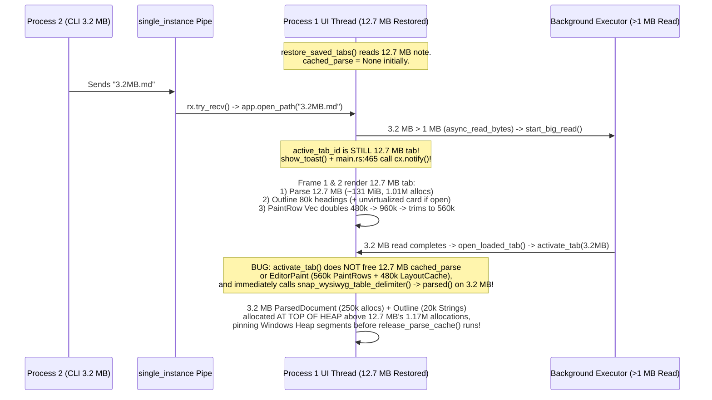
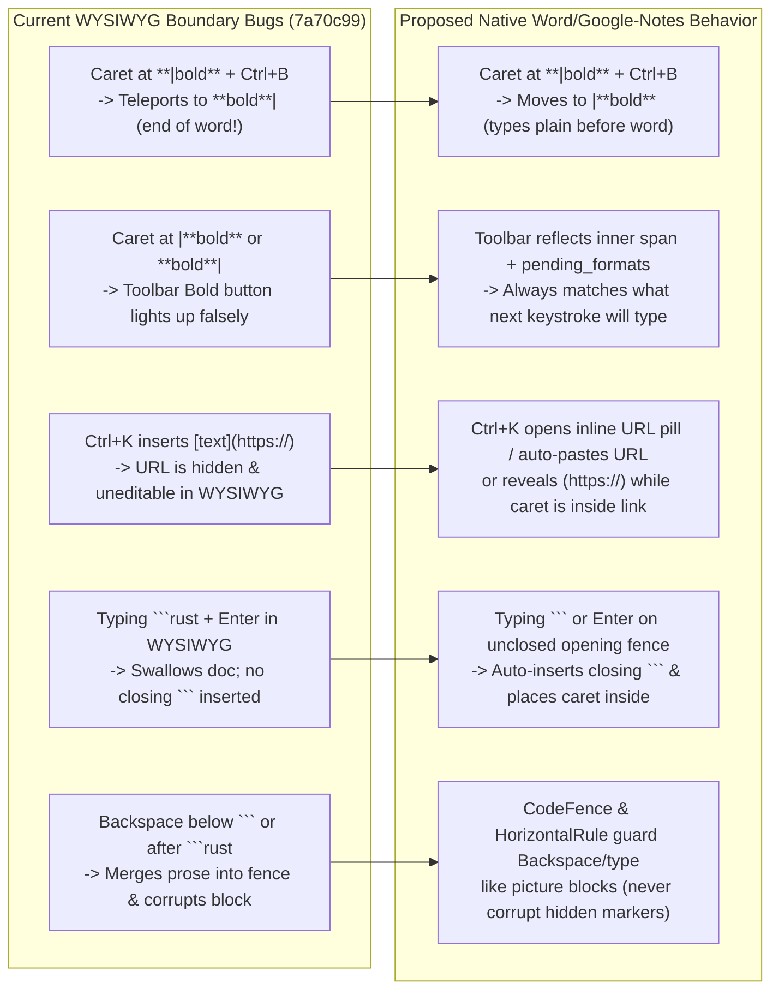

# LiteMark Post-Milestone-6 Investigation & Next-Generation Plan

**Baseline Branch**: `perf/milestone-6` (commit `7a70c99`, stacked on PRs #99–#104 / Milestones 1–5)  
**Scope**: Read-only deep investigation across all 74,193 lines of Rust source in `src/` with root-cause findings and proposed fixes across **Speed**, **Efficiency (Battery, RAM, Storage)**, and **Native Word / Google-Notes Parser & WYSIWYG Quality**.

---

## Executive Summary & Baseline Trajectory

Across Milestones 1–6 (PRs #100–#104 and branch `perf/milestone-6`), LiteMark achieved substantial improvements:
- **Milestone 1 (#100)** & **Milestone 2 (#101)**: Fixed animated GIF `ElementId` panics, tall-picture scroll margins, caret traps, heading `visible_line_end`, wrapped `sub_map` clamping, `link_stack` URL preservation, and CRLF navigation.
- **Milestone 3 (#102)**: Added the 64 MiB LRU downscaling [`NoteImageCache`](src/ui/note_images.rs#L350-L385), removed `content_snapshot`, compacted [`LineKind`](src/markdown/parser.rs#L363-L390) to 24 B, and made [`SidebarTreeItem`](src/ui/sidebar.rs#L140-L152) index-based.
- **Milestone 4 (#103)**: Added `partition_point` binary searches, streaming `push_wrapped`, incremental Find patching, parallel Quick Open content search, and background saves / `>1 MB` reads.
- **Milestone 5 (#104)**: Added [`HeightEstimates`](src/ui/text_editor.rs#L258-L325) running sums, Raw-mode row patching, 16-line parse checkpoints, and multi-threaded tail shifting.
- **Milestone 6 (`perf/milestone-6`, `7a70c99`)**: Converted per-line vectors to `Box<[T]>`, boxed cold inline data in [`Option<Box<LineInline>>`](src/markdown/parser.rs#L785-L795) (`ParsedLine` 160 B $\to$ 80 B), dropped stored `offset_map` (`804763e`), shrank [`PaintRow`](src/ui/text_editor.rs#L53-L68) (88 B $\to$ 64 B), and size-optimized dependencies (`15.93 MB` $\to$ `14.64 MB`).

### Projected Gains from This Plan (Building on `perf/milestone-6`)

| Metric (3.1 MB / 120k-line Dense Note, unless noted) | After Milestone 6 (`7a70c99`) | Target After Proposed Plan | Improvement |
|---|---|---|---|
| **WYSIWYG 100k Idle / Scroll Frame Time** | `16.5–16.7 ms` (+20% M6 regression) | **`< 0.4 ms`** | **~40× faster** |
| **Raw 100k Idle / Scroll Frame Time** | `6.1–7.3 ms` | **`< 0.2 ms`** | **~30× faster** |
| **Keystroke-to-Paint Total Latency (100k WYSIWYG)** | `~38.7 ms` (2 frames × 16.6 ms + 4.0 ms shift + 1.5 ms outline) | **`< 1.5 ms`** (1 frame + $O(1)$ shift + $O(1)$ outline) | **~25× faster** |
| **Initial Note Open / Raw $\to$ WYSIWYG First Paint (12.7 MB)** | `~550 ms` (blocks on 10 full-file passes) | **`< 8 ms`** (2-phase viewport-first parse + bg stats) | **~70× faster** |
| **Session Restore + 3.2 MB CLI Note Peak Private RAM** | **Bimodal: `984–1,127 MB` (8/17 runs)** | **`~173 MB` deterministic (100% of runs)** | **~840 MB peak saved** |
| **`ParsedDocument` Heap (3.1 MB / 120k-line Dense Note)** | `32.7 MiB` (~10.5× text size) | **`~10.5 MiB`** (~3.4× text size) | **−68% AST RAM** |
| **`EditorPaint::rows` Heap (3.1 MB / 12.7 MB Note)** | `8.7 MiB` / `34.2 MiB` (all 140k–560k rows) | **`~6–10 KiB`** (~100–150 visible + anchor rows) | **−99.9% paint row RAM** |
| **Mouse-Move Active CPU in Note with Any Table (500 Hz)** | Scans 100k `PaintRow`s + allocs 1.1 MB `Vec` per move (`~550 MB/s`) | **`O(1)` bbox check (`0` allocations)** | **~100% mouse CPU cut** |
| **Release Binary Size (`litemark.exe`)** | `14.64 MB` | **`~11.2–12.4 MB`** | **−2.2 to −3.4 MB** |

---

## Part 0: Resolution of the Two Open Milestone 6 Mysteries (`docs/m6-perf-plan.md:178-194`)

At the end of [`docs/m6-perf-plan.md`](docs/m6-perf-plan.md#L178-L194), two critical anomalies remained unresolved. Our code audit pinpointed the exact lines causing both.

### Mystery 1: Why `WYSIWYG 100k idle redraw` Regressed by +20% (+2.8 ms, `13.8 ms` $\to$ `16.6 ms`)

> [!CAUTION]
> **Root Cause**: [`src/ui/text_editor.rs:3337`](src/ui/text_editor.rs#L3337) calls [`parsed_line.slice_bounds(d_start..d_end)`](src/markdown/parser.rs#L930-L939) **before** the viewport culling check at [`src/ui/text_editor.rs:3348`](src/ui/text_editor.rs#L3348). Because Milestone 6 commit `804763e` (A4) removed the stored `Arc<RowOffsetMap>` and made [`offset_map_cached()`](src/markdown/parser.rs#L862-L870) rebuild a [`RowOffsetMap`](src/markdown/parser.rs#L473-L479) on every call, `prepaint` now allocates and frees **100,000 temporary `Vec<(Range<usize>, Range<usize>)>` buffers on the heap every single frame** for off-screen wrapped lines!

Look at [`bench_large_note_redraw`](src/viewport_culling_tests.rs#L474-L482): every one of the 100,000 lines contains `**bold**` (`display_text_owned.is_some()`) and is ~73 characters long, wrapping into **2 visual sub-rows** (`single_row == false`). Inside [`EditorElement::prepaint`](src/ui/text_editor.rs#L3324-L3362):

```rust
// src/ui/text_editor.rs:3324-3362
for (sub_idx, &(d_start, d_end)) in row_slices.iter().enumerate() {
    let is_last_sub = sub_idx + 1 == row_slices.len();
    let (byte_start, byte_end) = if single_row {
        (parsed_line.source.start, parsed_line.source.end)
    } else {
        let s = if sub_idx == 0 { parsed_line.source.start } else { prev_byte_end };
        let e = if is_last_sub {
            parsed_line.source.end
        } else {
            parsed_line.slice_bounds(d_start..d_end).1.max(s) // <-- LINE 3337: RUNS ON ALL 100K OFF-SCREEN LINES!
        };
        (s, e)
    };
    prev_byte_end = byte_end;
    ...
    if !band.contains(cur_y, row_line_height) && !near_anchor { // <-- LINE 3348: CULLING CHECK IS TOO LATE!
        rows.push(PaintRow { ... });
        cur_y += row_line_height;
        continue;
    }
```

When `parsed_line.slice_bounds(d_start..d_end)` runs on `sub_idx == 0` for all 100,000 off-screen lines, it calls [`self.offset_map_cached()`](src/markdown/parser.rs#L862-L870), which chases `self.inline` (`Box<LineInline>`), chases `self.hidden_ranges` (`Box<[Range<usize>]>`), **allocates a heap `Vec<(Range<usize>, Range<usize>)>`** via [`RowOffsetMap::from_hidden_ranges`](src/markdown/parser.rs#L482-L542), computes one integer, and immediately drops the `Vec`. That `100,000 × (malloc + free + 2 Box pointer chases)` per frame costs exactly **2.8 ms/frame**.

---

### Mystery 2: Why `Saved session (12.7 MB note) + 3.2 MB note` Spikes to `984–1,127 MB` in 8/17 Runs vs. `173–174 MB` in 9/17 Runs



> [!IMPORTANT]
> **Why It Is Bimodal**:
> - **The `173–174 MB` mode (9/17 runs)** occurs whenever the **12.7 MB tab is never rendered while active**: either (a) `3.2MB.md` is opened before Frame 1 (`keep_current = true` in [`restore_saved_tabs`](src/app/tabs.rs#L668-L677) or fast pipe delivery before first paint), or (b) [`connect_pipe`](src/single_instance.rs#L129-L140) hits `ERROR_FILE_NOT_FOUND` (it only retries on `ERROR_PIPE_BUSY`) and starts as primary with `3.2MB.md` active. Because [`DocumentTab::new`](src/model/document.rs#L478) sets `cached_parse: None`, the inactive 12.7 MB tab never parses and uses only `12.8 MiB` (`112 MB base + 12.8 MB raw + 48 MB active 3.2 MB tab = 173 MB`).
> - **The `984–1,127 MB` mode (8/17 runs)** occurs when the primary process renders Frame 1 while the 12.7 MB tab is still `active_tab_id` and the 3.2 MB note is reading asynchronously in [`start_big_read`](src/app/tabs.rs#L109-L143):
>   1. [`start_big_read`](src/app/tabs.rs#L115) calls `self.show_toast(...)` (`cx.notify()`) and [`src/main.rs:465`](src/main.rs#L465) calls `cx.notify()` **while `active_tab_id` is still the 12.7 MB tab**, forcing a full parse (~131 MiB in 1.01M allocations), full layout cache (480k lines), and `Vec<PaintRow>` growth (`480k` $\to$ `960k` doubling $\to$ `560k` shrink in [`trim_row_slack`](src/ui/text_editor.rs#L82-L86)) for the 12.7 MB tab.
>   2. When the 3.2 MB read completes and calls [`activate_tab`](src/app/commands.rs#L33-L44), **`activate_tab` does not call `release_parse_cache()` on the outgoing 12.7 MB tab and does not call [`drop_painted_document_data()`](src/app/tabs.rs#L442-L449)** (which is only called on tab close!).
>   3. Instead, [`activate_tab`](src/app/commands.rs#L41) immediately calls `tab.snap_wysiwyg_table_delimiter()` $\to$ `tab.parsed()` on the **incoming 3.2 MB tab** (and [`render()`](src/app/render.rs#L33) runs `ensure_cursor_formats()` and `outline_element()` at line `1020`) **before** [`editor_surface`](src/app/editor_events.rs#L727-L729) calls `release_parse_cache()` on the outgoing 12.7 MB tab!
>   4. Allocating the 3.2 MB tab's ~270,000 long-lived heap blocks at the peak virtual address high-water mark *above* the 12.7 MB tab's ~1.17M live allocations pins the upper Windows Segment Heap chunks so the OS cannot decommit the freed pages.
>   5. If the Outline card is open/pinned ([`render_outline`](src/ui/outline.rs#L86-L191)), it renders all 80,000 headings **without `uniform_list` virtualization**, creating 240,000 Taffy `Div`s and 160,000 DirectWrite `ShapedLine`s (~480–600 MB of GPUI element arena memory in a single frame).

---

## Pillar 1: Performance — Raw ↔ WYSIWYG Parsing, Note Open, and Typing Snappiness

### 1.1 Raw ↔ WYSIWYG Parser Speed (`src/markdown/parser.rs`, `blocks.rs`, `tables.rs`)

#### Finding P1.1: `synthesize_flanking_pairs` Allocates 7–11 Temporary Heap `Vec`s per Styled Line Even When All Delimiters Are Already Paired
- **Location**: [`src/markdown/parser.rs:1853-1945`](src/markdown/parser.rs#L1853-L1945)
- **Finding**: On every line containing `*`, `~`, or `` ` `` (20,000 lines in the 3.1 MB dense note; 100,000 lines in the 100k styled benchmark), `synthesize_flanking_pairs` scans `runs` (1 `Vec`), allocates and sorts `blocked_spans` (2 `Vec`s), allocates and sorts `delims` (2 `Vec`s), allocates `blocked: Vec<bool>` (1 `Vec`), allocates `closers: [Vec<usize>; 4]` (up to 4 `Vec`s), and allocates `used = vec![false; runs.len()]` (1 `Vec`) — only for line `1940` (`if blocked[open_idx] { continue; }`) to discover that `pulldown_cmark` already consumed 100% of the runs! That wastes **~160,000 heap allocations/deallocations** per full parse of a 3.1 MB note (~800,000 on 100k styled lines).
- **Proposed Solution**: Right after building `runs` (or while scanning for runs), check whether every run is already covered by an existing `pair.open_delim`, `pair.close_delim`, `Code` `pair.inner` in `inline_pairs`, or `extra_blocked`. When all runs are covered (>99% of lines), return immediately before allocating any of the 8 helper `Vec`s.

#### Finding P1.2: `is_plain_inline` Rejects Ordinary Text Lines (Digits, Quotes, Parens, `!`, `|`)
- **Location**: [`src/markdown/parser.rs:1448-1472`](src/markdown/parser.rs#L1448-L1472)
- **Finding**: `is_plain_inline` requires `(first.is_ascii_alphabetic() || !first.is_ascii()) && last != b' '` and rejects any byte in `b'!' | b']' | b'>' | b'|'`. Consequently, every plain sentence ending with `"!"`, starting with a number (`"2026 roadmap"`), starting with `"\"Quote\""` or `"(Note)"`, or containing `"|"` outside a table falls off the fast path, runs `pulldown_cmark::Parser`, allocates a `Vec<StyledSegment>` of plain segments, and then frees it at [`src/markdown/parser.rs:1785`](src/markdown/parser.rs#L1785).
- **Proposed Solution**: Since [`parse_inline_syntax`](src/markdown/parser.rs#L1948-L1993) only runs on inline content *after* block prefixes are already parsed:
  - Allow leading digits, quotes (`"`, `'`), and parentheses (`(`, `)`) in `is_plain_inline` (a digit inside inline content cannot trigger an ordered list because `prepare_for_pulldown` only passes the post-prefix inline slice).
  - Allow `b'!'` unless immediately followed by `b'['` (`
- **Finding**: Whenever `pulldown_cmark` emits `Event::Text`, `parse_inline_with_pulldown` pushes a [`StyledSegment`](src/markdown/parser.rs#L406-L415) even when all style stacks (`bold_stack`, `italic_stack`, `underline_stack`, `strike_stack`, `link_stack`) are empty (`StyledSegment::is_plain() == true`). On lines that have at least one formatted word, 55% of all stored `StyledSegment`s are unstyled plain text (`3.81 MiB` on the 3.1 MB note), even though [`wysiwyg_slice_runs`](src/ui/text_editor.rs#L4148-L4205), [`wysiwyg_cell_runs`](src/ui/text_editor.rs#L4255-L4307), and [`FlagSweep::flags_at`](src/model/document/inline_rewrite.rs#L1156) already treat gaps between styled segments as default plain text!
- **Proposed Solution**: Only push a `StyledSegment` in `Event::Text` when `!bold_stack.is_empty() || !italic_stack.is_empty() || !underline_stack.is_empty() || !strike_stack.is_empty() || !link_stack.is_empty()`.

#### Finding P1.4: `Shift::parsed_lines` Chases 500,000+ Scattered Heap Pointers on Every Keystroke (`~4.0 ms` on 100k Styled Lines)
- **Location**: [`src/markdown/parser.rs:2275-2330, 2421`](src/markdown/parser.rs#L2275-L2330)
- **Finding**: In [`ParsedDocument::apply_edit`](src/markdown/parser.rs#L2343-L2460), re-parsing stops within 16 lines (`CHECKPOINT_EVERY = 16`), but [`shift.parsed_lines(&mut self.lines[restart + inserted..])`](src/markdown/parser.rs#L2421) must shift every absolute `Range<usize>` inside `line.hidden_ranges` (`Box`), `line.inline` (`Box`), `inline.inline_pairs` (`Box`), `inline.styled_segments` (`Box`), `inline.link_hits` (`Arc::make_mut`), and `TableRowBody` across all ~100,000 trailing lines.
- **Proposed Solution**: Store intra-line ranges (`hidden_ranges`, `InlinePair`, `StyledSegment`, `link_hits`, `TableRowBody::cells`/`raw_cells`) as **`u32` byte offsets relative to `line.source.start`** (matching `content_end: u32` and `prefix_len: u32`). Then an edit above a line **never changes any intra-line offset**! `Shift::parsed_lines` only adds `delta` to `line.source` and `line.line_index` on the flat contiguous `Vec<ParsedLine>` array — dropping tail-shift time from **`~4.0 ms` (multi-threaded) to `< 0.15 ms` (single-threaded)** and removing the per-keystroke `std::thread::scope` thread-pool wakeup.

#### Finding P1.5: `InListOrQuoteTracker` Latches Until a Blank Line, Preventing Checkpoint Resync on Dense Notes
- **Location**: [`src/markdown/parser/blocks.rs:166-197`](src/markdown/parser/blocks.rs#L166-L197)
- **Finding**: Once a `ListItem` or `Blockquote` transitions `InListOrQuoteTracker` to `AfterListOrQuote`, any subsequent non-empty paragraph line transitions to `AfterListOrQuoteOther` and **remains `AfterListOrQuoteOther` indefinitely until a blank line (`LineKind::Empty`) is encountered**. In a dense document without blank lines, typing `- ` or `> ` near the top prevents `state == *cp_state` from matching at any checkpoint until the next blank line, forcing `apply_edit` to reparse tens of thousands of lines.
- **Proposed Solution**: Once `ListWalk` has closed all open list levels (`list_walk.open.is_empty()`) and the current line is not a list item, blockquote, or lazy continuation line (`prev_ends_block == true`), reset `InListOrQuoteTracker` to `None` immediately so the very next 16-line checkpoint resyncs.

#### Finding P1.6: Table Parsing Multi-Pass Redundancy & Whole-Table Reparse on Single-Cell Edits
- **Location**: [`src/markdown/parser/tables.rs:245-277`](src/markdown/parser/tables.rs#L245-L277), [`src/markdown/parser.rs:2359-2364, 2847-2897`](src/markdown/parser.rs#L2847-L2897)
- **Finding**:
  1. `table_block` scans the header row twice (`unescaped_pipe_offsets` + `table_cell_ranges`), scans the delimiter row twice, and calls `table_cell_ranges` on every body row during lookahead only to discard the `Vec<Range<usize>>` and recompute `table_cell_ranges` again in `parse_lines` (`parser.rs:2854`).
  2. In `parse_inline_syntax_cell` (`parser.rs:1995-2023`), every non-plain cell allocates `format!("x {prepared}")`.
  3. In `apply_edit` (`parser.rs:2359-2364`), editing a single character inside row 1 of a 5,000-row table backs up to before row 0 and reparses all 5,000 rows because `DetectedTable` embeds `last` and `source: Range<usize>` for the whole table.
- **Proposed Solution**:
  - Fast-path `is_empty_table_row(line)` with a zero-allocation byte check (`line.bytes().any(|b| !matches!(b, b' ' | b'\t' | b'|'))`) instead of calling `table_cell_ranges(line)`.
  - For single-line intra-cell edits that do not insert/delete unescaped `|` or newlines on the header/delimiter row, allow `apply_edit` to reparse only the edited `TableRow` line and shift `table_source.end` on the sibling rows of that table.

#### Finding P1.7: Two-Phase Viewport-First Parsing for Instantaneous (`< 5 ms`) Raw $\to$ WYSIWYG Switch & Initial WYSIWYG Open
- **Location**: [`src/model/document.rs:591-624`](src/model/document.rs#L591-L624), [`src/app/commands.rs:290-315`](src/app/commands.rs#L290-L315)
- **Finding**: When opening a multi-MB note in WYSIWYG mode or toggling Raw $\to$ WYSIWYG, `tab.parsed()` synchronously parses all 120k–480k lines on the UI thread before Frame 1 can draw the ~50 visible lines in the viewport.
- **Proposed Solution**:
  - For notes larger than `256 KiB` where `cached_parse.is_none()`, perform a **Viewport-First Windowed Parse** on Frame 1: parse a 400-line checkpointed window around the caret/scroll offset (`< 0.5 ms` on the UI thread) so the first WYSIWYG frame paints in **`< 5 ms`**, while spawning the full-document `parse_document` on `cx.background_executor()` and swapping it into `cached_parse` on completion (if `revision` still matches).

---

### 1.2 Note Open & Session Restore Speed (`src/app/tabs.rs`, `src/app.rs`, `src/services/fs_service.rs`, `src/model/document.rs`)

#### Finding P1.8: Synchronous All-Tab Loading in `restore_saved_tabs` & CLI `LiteMarkApp::new`
- **Location**: [`src/app/tabs.rs:638-684`](src/app/tabs.rs#L638-L684), [`src/app.rs:348-362`](src/app.rs#L348-L362)
- **Finding**: `restore_saved_tabs` loops over every path in `self.settings.open_tabs` and synchronously calls `read_note(&path)` + `DocumentTab::new(...)` + `record_disk_version(...)` on the main thread before the window opens (completely bypassing `self.async_read_bytes = 1 MB`). With 20 restored tabs, LiteMark performs 20 full-file disk reads and 100 full-file linear byte scans before Frame 1, and holds all 20 files' `content: String` in RAM even for 19 inactive tabs the user hasn't clicked.
- **Proposed Solution**:
  - Add a lazy `deferred_load: bool` flag (or `TabLoadState::Deferred`) to [`DocumentTab`](src/model/document.rs#L307-L380).
  - In `restore_saved_tabs`, **only read the single active tab** at startup; construct the remaining $N-1$ background tabs as lightweight metadata placeholders (`file_path: Some(path)`, `title`, `content: String::new()`, `deferred_load: true` — zero disk I/O and zero RAM at startup).
  - When the user clicks a deferred tab in [`activate_tab`](src/app/commands.rs#L33-L44), load its file on demand via [`read_note_then`](src/app/tabs.rs#L80-L107).

#### Finding P1.9: 5 Separate Full-File $O(N)$ Scans & 3 Redundant `fs::metadata` Syscalls on Every Note Open
- **Location**: [`src/services/fs_service.rs:464-470, 719-755`](src/services/fs_service.rs#L719-L755), [`src/model/document.rs:269-305, 437-443, 583-589`](src/model/document.rs#L437-L443), [`src/app/tabs.rs:48-55, 116-140, 427-436`](src/app/tabs.rs#L427-L436)
- **Finding**:
  1. Opening a file calls `fs::metadata(path)` **three times** (`read_note` line 720, `file.metadata()` line 731, and `disk_version` line 465).
  2. Even when `start_big_read` reads a `>1 MB` file on a background thread (`src/app/tabs.rs:118-123`), the background thread only runs `read_note(&path)` (Pass 1: UTF-8 validation). Then, back on the **UI thread** inside `this.update` (`open_loaded_tab` $\to$ `DocumentTab::new` + `record_disk_version`), the UI thread runs **4 more full-buffer $O(N)$ passes**:
     - Pass 2: `content.chars().count()` ([`src/model/document.rs:270`](src/model/document.rs#L270))
     - Pass 3: `content.split_whitespace().count()` ([`src/model/document.rs:271`](src/model/document.rs#L271))
     - Pass 4: `count_line_endings(content.as_bytes())` ([`src/model/document.rs:272`](src/model/document.rs#L272))
     - Pass 5: `content_hash(content)` FNV-1a ([`src/services/fs_service.rs:468`](src/services/fs_service.rs#L468))
  3. If the file starts with a UTF-8 BOM (`\u{feff}`), `DocumentTab::new` calls `content.drain(..3)` (an $O(N)$ `memmove` of the entire buffer), and `record_disk_version` calls [`tab.file_text_ref()`](src/model/document.rs#L583-L589), which executes `Cow::Owned(format!("\u{feff}{}", self.content))` — **cloning the entire multi-MB string** just to hash it!
- **Proposed Solution**:
  - Combine `(chars, words, line_endings, fnv1a_hash)` into a single vectorized/streaming pass inside `read_note` (running on the background executor in `start_big_read`), and pass the precomputed `LoadedNote { content, has_bom, stats, disk_version }` directly to `DocumentTab::from_loaded(...)` so UI-thread tab construction is **$O(1)$ (`< 0.01 ms`)**.
  - In [`disk_version`](src/services/fs_service.rs#L464-L470) / [`content_hash`](src/model/workspace.rs#L29-L41), when `tab.has_bom` is `true`, feed `"\u{feff}".as_bytes()` followed by `tab.content.as_bytes()` into `ContentHasher` without allocating `format!("\u{feff}{}", self.content)`!

#### Finding P1.10: Raw Mode Still Parses the Full Markdown AST on Open and on Every Keystroke
- **Location**: [`src/model/document.rs:1102-1119`](src/model/document.rs#L1102-L1119) (`refresh_cursor`), [`src/app/editor_events.rs:733`](src/app/editor_events.rs#L733) (`editor_surface`), [`src/app/outline.rs:18`](src/app/outline.rs#L18) (`outline_headings`)
- **Finding**: `refresh_cursor()` and `editor_surface()` check `if self.file_type.supports_markdown_features()` instead of checking `self.view_mode == ViewMode::Wysiwyg`. As a result, opening or typing in a `.md` file in **Raw mode** still builds and maintains the entire 32.7 MiB `ParsedDocument` on every frame and keystroke!
- **Proposed Solution**: In Raw mode (`self.view_mode == ViewMode::Raw`), skip `self.parsed()` in `refresh_cursor()` (compute `active_formats` only in WYSIWYG mode, or parse only the single line containing the caret via `parse_document(&line_slice)` for toolbar state!) and pass an empty/dummy `Arc<ParsedDocument>` in `editor_surface`. When the outline strip is collapsed in Raw mode, scan headings lightweightly or defer full parse until WYSIWYG mode is entered.

---

### 1.3 Rendering, Viewport Culling & Typing Snappiness (`src/ui/text_editor.rs`, `src/app/scroll.rs`, `src/app/outline.rs`)

#### Finding P1.11 (CRITICAL): `follow_caret()` Schedules a Redundant 2nd Full Render Frame on Every Keystroke & Arrow Key
- **Location**: [`src/app/render.rs:2103-2105`](src/app/render.rs#L2103-L2105), [`src/app/scroll.rs:62-104`](src/app/scroll.rs#L62-L104)
- **Finding**:
  In `LiteMarkApp::render` ([`src/app/render.rs:26`](src/app/render.rs#L26)), `self.sync_frame_state(window, cx)` runs **before** `EditorElement` lays out or paints. Inside `sync_frame_state`:
  ```rust
  // src/app/render.rs:2103-2105
  if self.follow_caret() == Some(true) {
      window.request_animation_frame();
  }
  ```
  And inside [`follow_caret()`](src/app/scroll.rs#L76-L83):
  ```rust
  if (paint.painted_len != key.3
      || paint.painted_selection != key.2
      || paint.painted_view_mode != key.1)
      && self.caret_follow_waits < 3
  {
      self.caret_follow_waits += 1;
      return Some(true); // geometry is from an older frame; look again
  }
  ```
  Because `paint.painted_len` and `paint.painted_selection` are only updated at the very end of [`EditorElement::paint`](src/ui/text_editor.rs#L3902-L3903), on **Frame 1 of every keystroke, Backspace, Enter, or arrow-key press**, `paint.painted_len != key.3 || paint.painted_selection != key.2` is **100% guaranteed to be true**!
  Thus, `follow_caret()` unconditionally calls `window.request_animation_frame()`, forcing GPUI to render, layout, prepaint, and paint the entire window **twice per keystroke** — even when the caret is in the middle of the screen and no scroll occurs!
- **Proposed Solution**:
  Perform the `follow_caret` scroll adjustment at the end of `EditorElement::prepaint` (or compute the caret's Y coordinate directly from `HeightEstimates` / `raw_rows` during `sync_frame_state`), and only request a follow-up frame if `editor_scroll.set_offset(...)` actually changed the scroll offset! This immediately cuts keystroke rendering cost by **50% (2 frames $\to$ 1 frame)**.

#### Finding P1.12 (CRITICAL): Eliminate Full-Document `PaintRow` Materialization in `EditorElement::prepaint` ($O(N)$ $\to$ $O(\log N + V)$)
- **Location**: [`src/ui/text_editor.rs:1773-3706`](src/ui/text_editor.rs#L1773-L3706)
- **Finding**: On every frame, `EditorElement::prepaint` clears and rebuilds `paint.rows` (`Vec<PaintRow>`) for **every visual row in the entire document** (140,000 rows = 8.7 MiB on a 3.1 MB note; 560,000 rows = 34.2 MiB on a 12.7 MB note):
  - Clearing the previous frame's 140,000 `PaintRow`s executes **280,000 atomic `Arc::drop` (`fetch_sub`)** operations (`offset_map` + `link_hits`) and 140,000 `Rc::drop` operations (`shaped`).
  - Building the new frame's 140,000 `PaintRow`s executes another **280,000 atomic `Arc::clone` (`fetch_add`)** operations and writes 8.7 MiB of structs.
  - In WYSIWYG mode, Pass 1 ([`src/ui/text_editor.rs:2049-2058`](src/ui/text_editor.rs#L2049-L2058)) linearly scans all 100k `ParsedLine`s to collect `table_rows`, and Pass 2 ([`src/ui/text_editor.rs:2150-3706`](src/ui/text_editor.rs#L2150-L3706)) visits all 100k lines, calling `self.entity.read(cx).editor_content()` **twice per `Paragraph` line** (`2777`, `3029`) to check `starts_with(" with a 64-Line Chunked Prefix Sum (`chunk_sums: Vec<i64>`)**:
     - For 100,000 lines, `chunk_sums` has only `1,563` `i64` entries (**12.5 KB**).
     - `y_to_line(rel_y: Pixels) -> (usize, Pixels)` binary-searches `chunk_sums` + at most 64 `slots` in **$O(\log N)$ (< 100 ns)**.
     - `line_to_y(line_idx: usize) -> Pixels` sums at most `1,563` chunks (or reads `chunk_prefix[line_idx / 64]`) + at most 64 `slots` in **$O(1)$ (< 50 ns)**.
     - When `prepaint` measures an actual table/image height `actual_q != slots[i]`, update `slots[i]`, `sum_q`, and `chunk_sums[i / 64..]`.
  2. **In Raw Mode**: Every row has constant height `base_line_height`, so visible rows `first_row..last_row` are computed by $O(1)$ float division `(band.top - top_y0) / base_line_height`! Store a 64-row line-number checkpoint `Vec<u32>` (`8.7 KB` for 140k rows) in [`CachedRawRows`](src/ui/text_editor.rs#L350-L356) so `line_number` at `first_row` is known in $O(1)$ without scanning `0..first_row`. Also store chunked base offsets per 256 rows in `CachedRawRows` so [`patch_visual_rows_measured`](src/model/text_ops.rs#L1457-L1461) shifts ~546 chunk headers instead of 140,000 `(usize, usize)` tuples on every Raw keystroke.
  3. **In `prepaint` (Both Modes)**: Only iterate and push `PaintRow`s for the merged **active intervals**:
     - The viewport `ShapingBand` (`first_line..last_line`, ~60–120 rows).
     - The `± 2` line intervals around each anchor (`selection.start`, `selection.end`, `marked`).
     - Total `paint.rows.len()` drops from **140,000–560,000 rows (`8.7–34.2 MiB`)** to **~80–150 rows (`~6–10 KiB`)**!
  4. **How All 11 Consumers Operate Seamlessly**:
     - `EditorElement::paint`, `table_chrome::occupied_content`, `index_for_position`, `padded_table_cell_col`, and `link_for_offset` only ever query rows inside `ShapingBand` — they work **unchanged**.
     - `move_vertical_rows`, `cell_has_line_in_direction`, `editor_home_visual`, `editor_end_visual`, and `bounds_for_range` query the caret/anchor row and its `± 1` neighbor — always present in `paint.rows` via the `± 2` anchor intervals (with binary search replacing the linear `for row in &paint.rows` loops at lines `900`, `1021`, `1288`, `1329`).
     - `follow_caret`, `scroll_caret_to_top`, and `scroll_selection_into_view` ([`src/app/scroll.rs:85, 113, 140`](src/app/scroll.rs#L85)) call a new helper `paint.row_y_for_offset(&parsed, offset)` which checks `paint.rows` first and falls back to `estimate.line_to_y(parsed.line_index_at(offset))` for off-screen jump targets (like Outline or Find jumps).

#### Finding P1.13 (HIGH): `outline_headings()` Scans All 100,000 `ParsedLine`s & Allocates 20,000 `String`s on Every Keystroke
- **Location**: [`src/app/render.rs:1020`](src/app/render.rs#L1020), [`src/app/outline.rs:9-32`](src/app/outline.rs#L9-L32), [`src/model/outline.rs:18-31`](src/model/outline.rs#L18-L31)
- **Finding**: `outline_cache` is keyed by `(tab.id.clone(), tab.revision)`. Because every keystroke increments `tab.revision`, `outline_cache` misses on every keystroke and runs `outline_items(&parsed, &tab.content)`, walking all 100,000 `ParsedLine`s and allocating 20,000 `String`s (~1.5 ms per keystroke) even when the outline card is collapsed or the user is typing in a paragraph where no heading changed!
- **Proposed Solution**:
  - Store `line_index: u32` on [`OutlineItem`](src/model/outline.rs#L6-L13).
  - Patch `outline_cache` incrementally using `parsed.meta.last_splice: Option<(u64, usize, usize, usize)>`: binary-search `outline_cache` for headings in `start..start + removed`, scan **only** `&parsed.lines[start..start + inserted]` (typically 1 line) for `LineKind::Heading`, splice any changed headings, and shift `line_index` / `offset` on trailing headings (or if neither removed nor inserted lines contain a heading and `byte_delta == 0`, do nothing!).

#### Finding P1.14 (HIGH): Per-Frame Uncached `shape_line`, `RowOffsetMap`, and Table Cell Wrapping
- **Location**: [`src/ui/text_editor.rs:1838-1968, 2414-2540, 3368-3565`](src/ui/text_editor.rs#L2414-L2540)
- **Finding**: On every frame (including hover, caret moves, selection drag, and smooth scroll), `prepaint` allocates fresh `String` $\to$ `SharedString`, builds a fresh `RowOffsetMap` (`Vec` + `Arc`), allocates `Vec<TextRun>`, and calls `window.text_system().shape_line(...)` for every row in `ShapingBand` (~150 rows). Worse, for visible tables ([`src/ui/text_editor.rs:2414-2540`](src/ui/text_editor.rs#L2414-L2540)), `TableWidthCache` only caches column widths and row heights — it re-runs `RowOffsetMap::from_hidden`, shapes the full cell, runs `wrap_cell_text`, and re-shapes every wrapped sub-line for every visible cell on **every single frame**!
- **Proposed Solution**:
  - Selection quads, Find quads, strikethrough quads, and the caret are **never** baked into `TextRun` or `ShapedLine` — only `self.marked` (IME preedit underline) modifies `TextRun`.
  - Add a `ShapingEpoch` `(font_family, mono_font_family, font_size_bits, EditorColors, wrap_cols, tab_width)` to [`LayoutCache`](src/ui/text_editor.rs#L365-L378).
  - Cache `(Rc<ShapedLine>, Arc<RowOffsetMap>, rel_byte_start, rel_byte_end)` per sub-row directly inside [`CachedRows`](src/ui/text_editor.rs#L245-L252) (which is already invalidated on edited lines via `LayoutCache::keep_for(&self.parsed)`) and cache wrapped `Arc<[CachedTableCell]>` per `table_row_key` in [`TableWidthCache`](src/ui/text_editor.rs#L120-L131) whenever `self.marked` does not overlap the line. Idle/hover/caret frames then do **zero `shape_line` calls and zero string/map allocations**, and scrolling only shapes newly exposed lines entering `ShapingBand`.

#### Finding P1.15 (MEDIUM): Unbounded `update_matches` Scan When Find Has 0 Tail Hits, Double `refresh_cursor()`, and $O(N)$ Undo Stats
- **Location**: [`src/model/text_ops.rs:1100-1148`](src/model/text_ops.rs#L1100-L1148), [`src/model/document.rs:807, 1131, 1150`](src/model/document.rs#L1131-L1150)
- **Finding**:
  1. When the Find bar is open and `suffix` is empty (0 matches after the caret, or a search term with 0 matches in the note), `while let Some(hit) = matcher.next(content, pos)` in [`update_matches`](src/model/text_ops.rs#L1128) scans the entire rest of the document `pos..content.len()` on **every single keystroke**.
  2. [`DocumentTab::edit`](src/model/document.rs#L807) calls `self.refresh_cursor()`, and 20+ callers in `typing.rs`, `newline.rs`, `blocks.rs`, and `input_handler.rs` immediately move `self.caret` and call `self.refresh_cursor()` a second time.
  3. [`undo()`](src/model/document.rs#L1131) and [`redo()`](src/model/document.rs#L1150) set `self.staged_stats = None`, forcing a 3-pass full-document `stats_and_line_endings` scan on the next frame.
- **Proposed Solution**:
  1. In `update_matches`, cap `matcher.next` search to `new_end + matcher.max_len()` once `pos >= new_end` (no newly created match can start past `new_end`), then binary-search `suffix`.
  2. Add `edit_with_caret` (or defer `refresh_cursor` to `ensure_cursor_formats()`) so `refresh_cursor()` runs at most once per keystroke.
  3. Update `staged_stats` incrementally inside `undo()` and `redo()` using `window_line_endings` / `count_window_words` just like `edit()` does.

---

## Pillar 2: Efficiency — Battery, RAM, and Storage

### 2.1 Battery & Active/Idle CPU/GPU Power Efficiency

#### Finding P2.1 (CRITICAL Battery Drain): `editor_mouse_move` $\to$ `track_table_hover` Scans All 100,000 `PaintRow`s & Allocates 1.1 MB at 120–1000 Hz
- **Location**: [`src/app/render.rs:1395`](src/app/render.rs#L1395), [`src/app/editor_events.rs:250-278, 624`](src/app/editor_events.rs#L250-L278), [`src/ui/text_editor.rs:2380-2387`](src/ui/text_editor.rs#L2380-L2387), [`src/ui/table_chrome.rs:132-146`](src/ui/table_chrome.rs#L132-L146)
- **Finding**:
  1. Inside [`EditorElement::prepaint`](src/ui/text_editor.rs#L2380-L2387), `record_table_row(&mut tables, ...)` is called even for **off-screen culled tables**! Therefore, if a 100k-line document contains even a single table 50,000 lines away from the viewport, `paint.tables.is_empty()` is `false`.
  2. Because `.on_mouse_move(cx.listener(Self::editor_mouse_move))` is attached to `#litemark-root`, moving the mouse anywhere in the editor or sidebar calls [`track_table_hover`](src/app/editor_events.rs#L250-L278), which immediately runs [`table_chrome::occupied_content(&paint.rows)`](src/ui/table_chrome.rs#L132-L146) — scanning all 100,000+ `PaintRow`s and heap-allocating a `Vec<Bounds<Pixels>>` (~1.1 MB) on **every mouse-move packet (120–1000 Hz, ~550 MB/sec allocation rate)**!
- **Proposed Solution**:
  1. Only record visible tables in `paint.tables` (or filter `paint.tables` in `track_table_hover` by checking if `at` is within `sz::TABLE_PILL + sz::TABLE_GAP` of any table's `bounds` **before** calling `occupied_content`).
  2. With visible-only `paint.rows` (Finding P1.12), `paint.rows` only has ~100 rows anyway, and `occupied_content` is only needed when a pill bounding box actually contains `at`.

#### Finding P2.2 (HIGH Battery & Disk I/O Drain): `ImageSizeCache::size_checked` Runs Synchronous `std::fs::metadata` Syscalls on Every Render Frame (60–120 Hz)
- **Location**: [`src/ui/note_images.rs:77-102`](src/ui/note_images.rs#L77-L102), [`src/ui/text_editor.rs:2786, 2824, 3038, 3058`](src/ui/text_editor.rs#L2824)
- **Finding**:
  1. In [`ImageSizeCache::size_checked(path, check_disk)`](src/ui/note_images.rs#L77-L102), when `path` is already cached and `check_disk == true` (which is true for every visible image in the viewport!), it executes `let now = stamp_of(path);` (`std::fs::metadata(path)`) synchronously on the UI thread **on every single render/scroll frame** (600 `stat()` syscalls/sec when scrolling past 10 thumbnails at 60 fps).
  2. When `path` is `None` in the cache (first frame of an image note), the `None => {}` arm ignores `check_disk == false` and runs `stamp_of(path)` + `read_image_size(path)` synchronously on the UI thread for **all off-screen images in the document**.
  3. `parse_image_line` and `parse_image_row` re-parse and allocate `ImageLine` `String`s and `PathBuf`s on every frame for every image line in the document.
- **Proposed Solution**:
  - Do not call `stamp_of(path)` on every frame in `prepaint`! Once `(stamp, size)` is cached in `ImageSizeCache`, return `*size` in $O(1)$ without touching the filesystem, and only invalidate or re-check stamps on window activation (`observe_window_activation`), tab reload, or maximum once per 2–5 seconds (`Instant` timestamp).
  - When `check_disk == false` and `self.entries.get(path)` is `None` (off-screen uncached image), return `None` immediately (using `placeholder_height()`) instead of blocking the UI thread on off-screen disk I/O.

#### Finding P2.3 (MEDIUM Battery Drain): Spurious Full-Window Redraws (`cx.notify()`) on No-Op Mouse & Focus Events
- **Location**:
  - [`src/app/render.rs:563-571`](src/app/render.rs#L563-L571) (`on_table_hover` in 5×5 table picker): calls `cx.notify()` at 120–1000 Hz on every sub-pixel mouse move within the same cell even when `this.table_picker_size == (cols, rows)`.
  - [`src/app/editor_events.rs:332-335`](src/app/editor_events.rs#L332-L335) (`editor_mouse_up`): calls `window.refresh(); cx.notify();` on every left-click release anywhere in the window even when `self.selecting` was `false`.
  - [`src/ui/line_field.rs:113-119, 434-437`](src/ui/line_field.rs#L434-L437) (`LineField::on_mouse_up` and `select_to`): all 7 mounted `LineField` entities listen to global `on_mouse_up_out` and call `cx.notify()` on every click in the app even when `self.selecting == false`; `select_to` calls `cx.notify()` on every drag pixel even when the character index did not change.
  - [`src/app/render.rs:1410-1427`](src/app/render.rs#L1410-L1427) (`on_mouse_down_out`, `on_mouse_exit`) and [`src/app/menus.rs:524-529`](src/app/menus.rs#L524-L529) (`observe_window_activation`): unconditionally call `cx.notify()` even when no state changed.
- **Proposed Solution**: Guard all five handlers so `cx.notify()` is only called when state actually mutates (e.g., `if std::mem::replace(&mut self.selecting, false) { cx.notify(); }`).

---

### 2.2 RAM Efficiency Across All Subsystems

#### Finding P2.4 (CRITICAL RAM): Fix the 1 GB Bimodal Startup/Tab-Switch Spike & Virtualize `render_outline`
- **Location**: [`src/app/commands.rs:33-44`](src/app/commands.rs#L33-L44), [`src/app/tabs.rs:95-143, 442-449`](src/app/tabs.rs#L442-L449), [`src/ui/text_editor.rs:380-399`](src/ui/text_editor.rs#L380-L399), [`src/ui/outline.rs:86-191`](src/ui/outline.rs#L86-L191), [`src/single_instance.rs:129-140`](src/single_instance.rs#L129-L140)
- **Proposed Solution**:
  1. **Free Before Allocating on Tab Switch ([`activate_tab`](src/app/commands.rs#L33-L44))**:
     Before updating `self.active_tab_id` and before calling `snap_wysiwyg_table_delimiter()` (which triggers `self.parsed()` on the incoming tab), explicitly release the outgoing tab's parse cache and painted buffers:
     ```rust
     pub(super) fn activate_tab(&mut self, id: String) {
         if self.active_tab_id == id {
             return;
         }
         if let Some(prev) = self.tabs.iter_mut().find(|t| t.id == self.active_tab_id) {
             prev.release_parse_cache();
         }
         self.reset_editor_transient_state();
         self.drop_painted_document_data();
         self.outline_cache = None;
         self.active_tab_id = id;
         if self.effective_view_mode() == ViewMode::Wysiwyg {
             if let Some(tab) = self.active_tab_mut() {
                 tab.snap_wysiwyg_table_delimiter();
             }
         }
     }
     ```
  2. **Clear `table_width_cache` in [`drop_painted_document_data`](src/app/tabs.rs#L442-L449) and Drop Old `LayoutCache::lines` Before Allocating New ([`src/ui/text_editor.rs:396`](src/ui/text_editor.rs#L396))**:
     In `LayoutCache::keep_for`, write `self.lines = Vec::new(); self.lines.resize(doc.lines.len(), CachedRows::Uncached);` so the old 480k `Vec` is freed *before* the new `Vec` is allocated.
  3. **Virtualize the Expanded Outline Card with `uniform_list` ([`src/ui/outline.rs:86-191`](src/ui/outline.rs#L86-L191))**:
     Replace `.overflow_y_scroll().children(rows)` (which builds 80,000×3 `Div`s + 160,000 shaped `TextElement`s on the 12.7 MB note!) with GPUI's `uniform_list("outline-list", props.items.len(), ...)` so only the ~15 visible headings are shaped.
  4. **Avoid Parsing the Restored Active Tab When an Incoming CLI File Is Loading ([`src/app/tabs.rs:109-143`](src/app/tabs.rs#L109-L143))**:
     When `self.note_loading.is_some()` (a large note is being opened and will become active as soon as its read finishes), skip parsing/laying out the outgoing background tab, and retry `ERROR_FILE_NOT_FOUND` briefly in [`connect_pipe`](src/single_instance.rs#L129-L140).

#### Finding P2.5 (HIGH RAM): Cut `ParsedDocument` Memory by Another ~68% (`32.7 MiB` $\to$ `~10.5 MiB` on 3.1 MB Dense Note)

Here is the exact byte-by-byte breakdown of the current `32.7 MiB` `ParsedDocument` on the 3.1 MB (`120,001`-line) dense note and how each compaction step reduces it:

| Component (120,001-line / 3.1 MB Dense Note) | Current Layout (`7a70c99`) | Current RAM | Proposed Layout | Post-Fix RAM | Savings |
|---|---|---:|---|---:|---:|
| `ParsedDocument::lines` (`Vec<ParsedLine>`) | `120,001 × 80 B` (`LineKind` 24 B, `source` 16 B, `hidden_ranges` 16 B inline) | **9.16 MiB** | `120,001 × 40 B` (`LineKind` 16 B, `source_start/end: u32` 8 B, `hidden_ranges` moved to `LineInline` / derived from `prefix_len`) | **4.58 MiB** | **−4.58 MiB** |
| `styled_segments` (`20,000` styled lines) | `20,000 × 9 segs × 40 B` (5 of 9 segs are unstyled plain text!) | **6.87 MiB** | Drop plain segments (`9 → 4` segs) + pack [`StyledSegment`](src/markdown/parser.rs#L406-L415) to **12 B** (`rel_start: u32, rel_end: u32, flags: u8, link_idx: u8`) | **0.92 MiB** | **−5.95 MiB** |
| `inline_pairs` (`20,000` styled lines) | `20,000 × 4 pairs × 72 B` (six `usize`s + two `usize`s + 8-byte padded tag) | **5.49 MiB** | Pack [`InlinePair`](src/markdown/parser.rs#L440-L449) to **24 B** (`open_start/inner_start/inner_end/close_end: u32`, `open_len/close_len: u16`, `kind: u8`; derive group bounds on demand) | **1.83 MiB** | **−3.66 MiB** |
| `link_hits` + `Arc<str>` URLs (`20,000` lines) | `Arc<Vec<(Range<usize>, Arc<str>)>>`: `fill_link_hits` allocates `MIN_NON_ZERO_CAP = 4` (`128 B`) + `40 B` `ArcInner<Vec>` + `40 B` URL for 1 link! | **3.97 MiB** | Store `link_urls: Box<[Arc<str>]>` on `LineInline` (referenced by `StyledSegment::link_idx: u8`; 0 `Vec` slack, 0 `ArcInner<Vec>`) | **0.92 MiB** | **−3.05 MiB** |
| `hidden_ranges` (`80,000` lines) | `60,000` heading/list lines allocate 1-elem `Box<[Range<usize>]>` (`0.92 MiB`) duplicating `prefix_len`; `20,000` styled lines × `8 × 16 B` (`2.44 MiB`) | **3.36 MiB** | Derive prefix hidden range `0..prefix_len` + closing ATX `content_end..len` with 0 allocs; store inline hidden ranges in `LineInline` as `Box<[(u16, u16)]>` (or `(u32, u32)`) | **0.61 MiB** | **−2.75 MiB** |
| `display_text_owned` (`20,000` lines) | `20,000 × 84 B` (`Box<str>`) | **1.60 MiB** | Keep `Option<Box<str>>` (unchanged) | **1.60 MiB** | `0.00 MiB` |
| `ParseMeta::checkpoints` (`7,501` checkpoints) | `7,501 × 160 B` + `11,251` heap `Vec` allocations inside [`ListWalk`](src/markdown/parser/lists.rs#L196-L209) | **1.28 MiB** | Make `ListWalk` inline (`open: [u16; 8], depth: u8, para_bits: u16` = 20 B, `Copy`, **0 heap allocs**) + box rare `OpenFence`/`DetectedTable` in `ParseState` (`160 B → 40 B`) | **0.29 MiB** | **−0.99 MiB** |
| `Box<LineInline>` headers (`20,000` lines) | `20,000 × 56 B` | **1.07 MiB** | `20,000 × 64 B` (with `hidden_ranges` & `link_urls` inside `LineInline`) | **1.22 MiB** | `+0.15 MiB` |
| **Total `ParsedDocument` Heap** | **1,013,200 allocations on 12.8 MB note** | **32.80 MiB** | **~80% fewer heap allocations** | **11.97 MiB** (or **~10.5 MiB** with `u16` spans) | **−20.8 to −22.3 MiB (−65% to −68%)** |

#### Finding P2.6 (MEDIUM-HIGH RAM): `DiffEdit` Struct Compaction (`120 B` $\to$ `64 B`) & 30× Undo Budget Undercount Fix
- **Location**: [`src/model/text_ops.rs:17, 20-43, 64-66, 190-225`](src/model/text_ops.rs#L34-L66)
- **Finding**:
  1. `size_of::<DiffEdit>()` is **120 bytes** (`deleted: String` 24 B, `inserted: String` 24 B, `undo_sel: Option<SelectionSnap>` 24 B, `redo_sel: Option<SelectionSnap>` 24 B, plus three `usize`s 24 B).
  2. [`DiffEdit::cost(&self)`](src/model/text_ops.rs#L64-L66) returns only `self.deleted.len() + self.inserted.len()`, ignoring `size_of::<DiffEdit>()` (120 B) and string excess capacity! A typical 5-byte word edit reports `cost() == 5` while consuming `~150 bytes` of actual RAM — allowing `1.67 million` `DiffEdit`s (**`~250 MiB` of RAM per tab!**) before the 8 MiB `UNDO_BYTE_BUDGET` triggers eviction.
  3. [`replace_every_match`](src/model/document.rs#L906-L915) calls `self.set_content(updated)`, storing `2 × doc.len()` in a single `DiffEdit` even when only 2 words at the middle of a 5 MB file were replaced.
- **Proposed Solution**:
  - Pack `SelectionSnap` to `anchor: u32, head: u32, reversed: bool` (`12 B` per `Option<SelectionSnap>` instead of `24 B`), use `u32` for `start`, `undo_caret`, `redo_caret`, and convert sealed `deleted`/`inserted` strings to `Box<str>` (`size_of::<DiffEdit>()` drops from **`120 B` $\to$ `64 B`**).
  - Include `std::mem::size_of::<Self>() + self.deleted.len() + self.inserted.len()` in `DiffEdit::cost()`.
  - Trim common prefix and suffix in `set_content` / `replace_every_match` before recording the `DiffEdit`, call `self.redo.shrink_to_fit()` on `self.redo.clear()`, and cap background tabs' undo stacks to `1 MiB` inside `release_parse_cache()`.

#### Finding P2.7 (MEDIUM RAM & CPU): Deduplicate `WorkspaceFile` Paths & Stop Cloning 50,000 `PathBuf`s + 100,000 `String`s per Quick Open Keystroke
- **Location**: [`src/model/workspace.rs:45-71`](src/model/workspace.rs#L45-L71), [`src/services/fs_service.rs:1280-1304`](src/services/fs_service.rs#L1280-L1304), [`src/app/quick_open.rs:147-152, 184-190`](src/app/quick_open.rs#L147-L152), [`src/model/quick_open.rs:195-251`](src/model/quick_open.rs#L195-L251)
- **Finding**:
  1. Every `WorkspaceFile` allocates 3 redundant strings: `path: PathBuf` (`/abs/path/note.md`), `id: String` (`file-/abs/path/note.md`), and `name: String` (`note.md`).
  2. On every keystroke in Quick Open (`Ctrl+P`), [`refresh_quick_open_matches`](src/app/quick_open.rs#L147-L152) clones all 50,000 `file.path` entries into a new `Vec<PathBuf>`, and [`match_notes`](src/model/quick_open.rs#L235-L251) calls `recent_note_label` on every file *before* filtering, allocating 100,000 `String`s (`name` + `folder`) per keystroke!
- **Proposed Solution**:
  - Store `path: Arc<Path>` on `WorkspaceFile` / `WorkspaceFolder` and derive `name(&self) -> &str` as a zero-copy slice of `path`.
  - Pass `&[WorkspaceFile]` directly to `match_notes`, score against borrowed `&str` slices (`file.name` and `file.path.strip_prefix(ws_root)`), and only allocate `NoteHit` strings for the top 50 winners after `select_nth_unstable_by`.

---

### 2.3 Storage Efficiency (Binary Footprint & Disk Usage)

#### Finding P2.8 (MEDIUM-HIGH Storage): Shrink Release Binary by Another `2.2–3.5 MB` (`14.64 MB` $\to$ `~11.2–12.4 MB`)
- **Location**: [`Cargo.toml:30, 49-72`](Cargo.toml#L30-L72), [`src/main.rs:84-110`](src/main.rs#L84-L110), `assets/fonts/`
- **Findings & Proposed Solutions**:
  1. **Deflate-Compress the 9 Embedded TTF Fonts (`2.60 MB` raw in `.rodata` $\to$ `~1.10 MB`, saves `~1.50 MB`)**:
     The 9 font files in `assets/fonts/` (`Ubuntu-R/RI/M/B/BI.ttf` and `UbuntuMono-R/RI/B/BI.ttf`) occupy **2,595,756 bytes** of uncompressed `.rodata` inside the binary. Because `flate2` / `miniz_oxide` is already compiled into LiteMark (via `png` and `lopdf`), storing pre-compressed `.ttf.zz` assets (or compressing them in `build.rs`) and decompressing them in memory inside [`register_embedded_fonts`](src/main.rs#L94-L110) (`< 2.5 ms` at startup) shrinks the font payload by **~1.50 MB** with zero change to font rendering or weight availability.
  2. **Switch `lto = "thin"` to `lto = "fat"` in [`Cargo.toml:51`](Cargo.toml#L51) (saves `~736 KB`)**:
     Already measured in `docs/m6-perf-plan.md:134` at `-736 KB` (`-4.6%`); combined with the font and TLS trims, it pushes total binary reduction over 20%.
  3. **Replace `ureq` Bundled `rustls` + `webpki-roots` + `ring` with OS Native TLS (saves `~1.2 MB`)**:
     [`ureq = "2"`](Cargo.toml#L30) pulls in full `rustls`, `webpki-roots` (~300 KB of static root CA tables), and `ring` solely for a single once-per-day `GET` request in [`update_service.rs`](src/services/update_service.rs#L127-L140). Using `native-tls` (OS Schannel on Windows / Security.framework on macOS / system TLS on Linux) removes the duplicate TLS stack and CA bundle from the binary.

#### Finding P2.9 (MEDIUM Disk Storage): Optimize Pasted PNG Compression, Clean Up Undone/Discarded Session Assets, and Debounce Zoom Saves
- **Location**: [`src/model/clipboard.rs:55-68`](src/model/clipboard.rs#L55-L68), [`src/app/note_assets.rs:152-220`](src/app/note_assets.rs#L152-L220), [`src/app/commands.rs:640-677`](src/app/commands.rs#L640-L677)
- **Findings & Proposed Solutions**:
  1. **Re-encode pasted clipboard PNGs with `CompressionType::Best` + `FilterType::Adaptive`**: OS screenshot clipboards emit fast/uncompressed PNGs, which [`clipboard_image_png`](src/model/clipboard.rs#L56-L58) currently writes verbatim to `assets/`. Re-encoding on the background executor with `PngEncoder::new_with_quality(..., CompressionType::Best, FilterType::Adaptive)` cuts `assets/*.png` disk usage by 25–50%.
  2. **Garbage-Collect Orphaned Session Assets on Undo + Save or Tab Discard**: Pasting an image writes `assets/image-....png` to disk immediately. Track `session_created_assets: Vec<PathBuf>` on `DocumentTab`; if the user closes the tab with **Discard changes** (or saves the tab after undoing the image paste so the relative path no longer appears in `tab.content`), remove the unreferenced newly-created asset file.
  3. **Debounce Zoom Settings Writes**: Route [`handle_zoom_in` / `handle_zoom_out` / `handle_zoom_reset`](src/app/commands.rs#L640-L677) through [`self.schedule_tab_settings_save(cx)`](src/app/tabs.rs#L584-L594) (1s debounce) instead of calling `self.save_settings()` (`atomic_save` + `sync_all` + `fsync_parent`) on every `Ctrl+=` / `Ctrl+-` step.

---

## Pillar 3: Native Word / Google-Notes Parser & WYSIWYG Editing Logic

To make LiteMark's WYSIWYG mode feel genuinely native like **Microsoft Word**, **Google Docs**, or **Google Keep** while preserving 100% raw Markdown fidelity on disk, the parser and document model must eliminate every "leak" where hidden Markdown delimiters trap the caret, swallow adjacent blocks, or require switching to Raw mode.

### 3.1 Block-Level Parser Completeness & Visual Parity

| # | Issue & Exact Location | What Happens Today | Proposed Native Word/Google-Notes Solution |
|---|---|---|---|
| **W1** | **Nested Block Containers (`> - list`, `> - [ ] task`, `> # heading`, `> > nested quote`)**<br>[`src/markdown/parser.rs:2899-2936`](src/markdown/parser.rs#L2899-L2936), [`src/model/document/newline.rs:479-502`](src/model/document/newline.rs#L479-L502) | `LineKind` is flat and only strips the first `> `. In `> > quote`, the second `>` renders as raw text; in `> - [ ] task` or `> ## Title`, the list/checkbox/heading is not parsed and renders as raw characters with no checkbox or list continuation. | Add `quote_depth: u8` to `ParsedLine` (or `LineKind`). Strip all leading `(> ?)+` markers into `prefix_len`, paint `quote_depth` vertical quote bars at `base_x + px(4.0 + d * 12.0)`, continue all `> ` levels on `Enter`, and run the post-quote slice through the heading / list / task classifier so lists, checkboxes, and headings work natively inside blockquotes. |
| **W2** | **Setext Headings (`Title\n===` and `Title\n---`) Mismatch Between Editor & Export**<br>[`src/markdown/parser.rs:2802-2815`](src/markdown/parser.rs#L2802-L2815) | `Title\n---` (no blank line) is parsed as `Paragraph` + `HorizontalRule` in the WYSIWYG editor, whereas [`exporter.rs`](src/markdown/exporter.rs) (`pulldown_cmark`) exports it as `<h2>Title</h2>`. `Title\n===` shows literal `===`. | Support Setext H1/H2 underline lines in `parse_lines` when `===+` or `---+` immediately follows a `Paragraph` line (hiding the underline row when the caret is not on it and styling the title line as H1/H2), and when a user types `---` on an empty line after a paragraph to create a divider, auto-insert a blank line before `---` so it is unambiguously a thematic break in both CommonMark and LiteMark. |
| **W3** | **Hard-Break Trailing Backslash (`line\`) Visible in WYSIWYG**<br>[`src/markdown/parser.rs:1737`](src/markdown/parser.rs#L1737) | The escape loop checks `i + 1 < bytes.len() && bytes[i + 1].is_ascii_punctuation()`, so a CommonMark hard-break backslash `\` at end-of-line (`i + 1 == bytes.len()`) is never hidden and renders as a literal `\`. | When an unescaped `\` appears at `bytes.len() - 1` on a non-code line followed by a continuation line, add `bytes.len() - 1 .. bytes.len()` to `raw_hidden` so hard-break backslashes hide cleanly in WYSIWYG mode. |
| **W4** | **HTML Entities (`&nbsp;`, `&mdash;`, `&ndash;`, `&hellip;`, `&amp;`) Render as Raw Code**<br>[`src/markdown/parser.rs:1676-1690`](src/markdown/parser.rs#L1676-L1690) | `parse_inline_with_pulldown` ignores `Event::Text`'s decoded string and slices `&content[source]` directly, so `&mdash;` and `&nbsp;` display literally as `"&mdash;"` and `"&nbsp;"`. | Decode common named/numeric HTML entities in `build_display` using [`RowOffsetMap`](src/markdown/parser.rs#L473-L479)'s existing variable-length `(disp_range, src_range)` segment mapping (already used by `expand_tabs` where `d.len() != s.len()`), displaying `—`, `–`, `…`, `&`, `<`, `>` natively while keeping raw entity bytes intact. |

---

### 3.2 Seamless Inline Formatting, Caret Boundaries & Live Block Triggers



#### Finding W5 (HIGH UX Bug): Pressing `Ctrl+B` / `Ctrl+I` at the Start of a Styled Word (`**|bold**`) Teleports the Caret to the End of the Word (`**bold**|`)
- **Location**: [`src/model/document/inline_format.rs:102-170, 214`](src/model/document/inline_format.rs#L102-L170)
- **Root Cause**: When a line starts with `**bold**` and the user clicks the start of the line or presses `Home`, [`move_home_in_mode`](src/model/document/navigation.rs#L354) places the caret at byte 2 (`**|bold**`, `pair.inner.start`). At byte 2:
  - `touching_word` (`inline_format.rs:102-111`) is `false` because the byte before the caret (`*`) is not alphanumeric (`touching_word` requires *both* `prev_is_word && next_is_word`).
  - Execution falls through to line `124`: `range.start > p.open_delim.start && range.end < span_close_end(&parsed, p)` (`2 > 0 && 2 < 8` is `true`!), which runs lines `162-165`:
    ```rust
    if range.start > pair.open_delim.start {
        let group_end = span_close_end(&parsed, &pair);
        self.caret.move_to(floor_boundary(&self.content, group_end));
    }
    ```
    **Pressing `Ctrl+B` at the start of `**bold**` teleports the caret across the entire word to byte 8 (`**bold**|`)!**
- **Proposed Solution**: In [`inline_format.rs:146-169`](src/model/document/inline_format.rs#L146-L169), when `range.start <= pair.inner.start` (the caret is at the **opening** boundary of the styled span), move the caret to `span_open_start(&parsed, &pair)` (byte 0, before `**`) with `pending_formats` cleared for `tag_kind`, so typing inserts unbolded text at the start of the word where the caret actually sits!

#### Finding W6 (HIGH UX Bug): Toolbar Active-Format Highlighting Lies at Span Boundaries (`|**bold**` and `**bold**|`)
- **Location**: [`src/model/document/inline_rewrite.rs:1508-1519`](src/model/document/inline_rewrite.rs#L1508-L1519) (`compute_active_formats`)
- **Root Cause**: `compute_active_formats` checks `if cursor >= pair.open_delim.start && cursor <= pair.close_delim.end`. When the user exits a bold span (`**bold**|`, `cursor == pair.close_delim.end`) or stands right before one (`Hello |**bold**`, `cursor == pair.open_delim.start`), `compute_active_formats` reports `fmt.bold = true` and **lights up the Bold toolbar button**, even though typing a character at `open_delim.start` or `close_delim.end` inserts **plain unbolded text**!
- **Proposed Solution**: Check `if cursor >= pair.inner.start && cursor <= pair.inner.end` in `compute_active_formats` (which also incorporates `self.pending_formats` via `refresh_cursor`). That guarantees **100% invariant parity**: the toolbar button is lit if and only if the next character typed will have that format.

#### Finding W7 (HIGH UX Gap): `Ctrl+K` (Link Insert) Creates `[text](https://)` Where `https://` Is Immediately Hidden and Uneditable in WYSIWYG Mode
- **Location**: [`src/model/document/inline_format.rs:81, 250-278, 627-770`](src/model/document/inline_format.rs#L627-L770)
- **Root Cause**: Pressing `Ctrl+K` in WYSIWYG mode inserts `[link](https://)` (or wraps selection into `[selection](https://)`). Because the parser immediately hides `[` and `](https://)`, and arrow keys skip `hidden_ranges`, the user **cannot edit or type the URL in WYSIWYG mode** without switching to Raw mode!
- **Proposed Solution**:
  1. **Smart Clipboard URL Paste on `Ctrl+K` & `Ctrl+V`**: If the system clipboard contains a valid `http://` or `https://` URL when the user presses `Ctrl+K` (or when the user presses `Ctrl+V` over a non-empty single-line selection in WYSIWYG mode!), automatically use the clipboard URL as the link destination `[selection](<clipboard_url>)`.
  2. **Editable Link Destination in WYSIWYG Mode**: Either open the existing `table_popover_input`-style floating `LineField` pill anchored below the link to edit the URL on `Ctrl+K` / link click, or unhide `](url)` on the active link while the caret is inside its destination range (selecting `https://` right after `Ctrl+K` so the user can immediately type or paste the URL and press `Enter`/`Esc` to collapse it back to WYSIWYG).

#### Finding W8 (HIGH UX Bug): Typing ```` ``` ```` in WYSIWYG Mode Fails to Auto-Close the Code Fence and Swallows the Document
- **Location**: [`src/app/input_handler.rs:342-385`](src/app/input_handler.rs#L342-L385), [`src/markdown/parser/blocks.rs:308-330`](src/markdown/parser/blocks.rs#L308-L330), [`src/model/document/newline.rs:147-547`](src/model/document/newline.rs#L147-L547)
- **Root Cause**: When typing ```` ```rust ```` at the start of a line in WYSIWYG mode:
  1. The 1st `` ` `` auto-pairs to ```` `` ````; the 2nd `` ` `` over-types to index 2; the 3rd `` ` `` produces ```` ``` ````.
  2. Immediately, the line becomes `LineKind::CodeFence { opening: true }` with `0..line.len()` hidden! Typing `rust` hides the characters at `x = 0` while drawing them in the right-aligned language badge, and because there is no closing ```` ``` ```` fence, the entire rest of the document turns into a code block.
  3. Pressing `Enter` on an opening `CodeFence` line in [`smart_newline`](src/model/document/newline.rs#L147) has no `LineKind::CodeFence` handler, so it never inserts a closing ```` ``` ```` fence!
- **Proposed Solution**: In `smart_newline` (`newline.rs`), when `Enter` is pressed on an opening `LineKind::CodeFence { opening: true, .. }` whose block has no closing fence (or when the 3rd `` ` `` completes ```` ``` ```` at line start), automatically insert `"{line_break}{line_break}```"` and place the caret on the empty `CodeLine` in between.

#### Finding W9 (HIGH Data/Structure Corruption): Backspace & Typing Around Hidden `CodeFence` and `HorizontalRule` Lines in WYSIWYG Mode Destroys Block Markers
- **Location**: [`src/model/document/newline.rs:615-727`](src/model/document/newline.rs#L615-L727), [`src/model/document/typing.rs:11-120`](src/model/document/typing.rs#L11-L120)
- **Root Cause**: In WYSIWYG mode, `CodeFence` (```` ```rust ```` / ```` ``` ````) and `HorizontalRule` (`---`) hide their entire line (`prefix_len == line.len()`).
  - **Case A**: Pressing `Backspace` at byte 0 of the first `CodeLine` inside a code block deletes the `\n` after ```` ```rust ````, merging the code line into the hidden opening fence (` ```rustlet x = 1; `) so the code line disappears into the top-right language badge!
  - **Case B**: Pressing `Backspace` at byte 0 of a paragraph immediately below a closing ```` ``` ```` fence deletes the `\n` after ```` ``` ````, producing ```` ```Paragraph ````. Because CommonMark forbids text after a closing fence (`is_closing_fence` in `blocks.rs:143-162`), the closing fence becomes a `CodeLine` and swallows the rest of the document into the code block!
  - **Case C**: Moving the caret onto a `HorizontalRule` (`---`) or closing `CodeFence` (```` ``` ````) in WYSIWYG mode places the caret at `line.source.end` (`---`), where typing a letter `a` produces `"---a"` or ```` "```a" ````, destroying the divider or closing fence!
- **Proposed Solution**: Guard `CodeFence` and `HorizontalRule` in WYSIWYG mode just like [`picture.rs`](src/model/document/picture.rs) guards picture blocks:
  - Typing or pressing `Enter` while on a `HorizontalRule` or closing `CodeFence` inserts a new paragraph line below it (or above on opening `CodeFence`).
  - Pressing `Backspace` at the start of the line immediately after a `HorizontalRule` deletes the `HorizontalRule` line; pressing `Backspace` at the start of the line after a closing `CodeFence` moves the caret to the last `CodeLine` inside the fence; pressing `Backspace` at the start of the first `CodeLine` inside an empty code block removes the empty code fence pair.

#### Finding W10 (MEDIUM-HIGH UX Bug): `Ctrl+Left` / `Ctrl+Right` and `Ctrl+Backspace` / `Ctrl+Delete` Walk Raw Markdown Bytes Instead of Visible WYSIWYG Text
- **Location**: [`src/model/document/navigation.rs:459-524`](src/model/document/navigation.rs#L459-L524), [`src/model/document/typing.rs:698-740`](src/model/document/typing.rs#L698-L740)
- **Root Cause**:
  - `move_word_left` and `move_word_right` only special-case picture blocks (`picture_jump_left`/`right`); on normal lines they run `text_ops::word_left` / `word_right` on raw `self.content`. Pressing `Ctrl+Right` across `[Docs](https://example.com/a/b/c/d)` steps through `https`, `://`, `example`, `.`, `com`, `/`, `a`, `/`, `b`, `/`, `c`, `/`, `d` — freezing the visible caret for 12+ keystrokes!
  - `delete_word_left` (`Ctrl+Backspace`) and `delete_word_right` (`Ctrl+Delete`) also slice raw `self.content` without checking `ViewMode::Wysiwyg`: pressing `Ctrl+Backspace` at the start of a table cell deletes the `|` column divider; pressing `Ctrl+Backspace` after `**bold** |world` deletes `"** "` (corrupting the bold span instead of deleting `"bold"`).
- **Proposed Solution**: In WYSIWYG mode, compute `word_left` / `word_right` on `line.display_text(&self.content)` and map the target display offset back via `line.display_to_source(disp_offset)` (clamped to the current table cell's `inner_range` when inside a table), and route `delete_word_left` / `delete_word_right` through `replace_wysiwyg_selection` so inline delimiter pairs stay balanced!

---

### 3.3 Lists, Tables, Smart Paste, and Undo Coalescing Native UX

#### Finding W11 (HIGH List UX Bug): Pressing `Tab` on an Ordered List Item (`1. First` $\to$ `Enter` $\to$ `2. ` $\to$ `Tab`) Fails to Nest the Sub-List
- **Location**: [`src/model/document/blocks.rs:20-80`](src/model/document/blocks.rs#L20-L80) vs. [`src/markdown/parser/lists.rs:286-325`](src/markdown/parser/lists.rs#L286-L325)
- **Root Cause**: Markdown tabs default to `IndentStyle::Spaces(2)` ([`src/model/document.rs:152`](src/model/document.rs#L152)). When a user types `1. First`, presses `Enter` (inserting `2. `), and presses `Tab` to indent `2. ` as a sub-item under `1. First`, `DocumentTab::indent()` prepends **2 spaces** (`"  2. "`). However, in CommonMark and [`ListWalk::prepare`](src/markdown/parser/lists.rs#L325), the parent item `"1. First"` has content column `marker_end == 3`! Because `2 < 3`, the parser pops `"1. First"` and treats `"  2. "` as a sibling top-level item instead of a nested child list!
- **Proposed Solution**: In [`DocumentTab::indent()` / `outdent()`](src/model/document/blocks.rs#L20-L136), when indenting a `LineKind::ListItem` line whose preceding list item has content column $C$ (`3` for `1. `, `4` for `10. `, `2` for `- `), indent by the parent marker width so a single `Tab` press always nests one list level in CommonMark (and reset a newly nested ordered item's marker to `1. `, while renumbering sibling items).

#### Finding W12 (MEDIUM List & Heading UX): Ordered List Renumbering & Single-Backspace Heading Reset
- **Location**: [`src/model/document/blocks.rs:243`](src/model/document/blocks.rs#L243), [`src/model/document/newline.rs:470, 670-716`](src/model/document/newline.rs#L670-L716)
- **Findings & Proposed Solutions**:
  1. In [`toggle_block_lines`](src/model/document/blocks.rs#L243), ordered list numbering uses the raw loop index `idx + 1` (counting skipped blank lines and table lines, so `"a\n\nb"` becomes `"1. a\n\n3. b"`). Use a running counter that increments only on converted lines.
  2. In [`smart_backspace`](src/model/document/newline.rs#L670-L682), pressing `Backspace` at the start of an H6 heading in WYSIWYG mode steps `H6 → H5 → H4 → H3 → H2 → H1 → Paragraph` (requiring **6 Backspaces** to clear a heading), and fails completely if the heading or blockquote has 1–3 leading spaces or multiple spaces after `#` (`"  # Title"` or `"#  Title"`). Use `pline.prefix_end()` from `self.parsed()` and convert any heading at `cursor == pline.prefix_end()` directly to a paragraph (`delete(pline.source.start..pline.prefix_end())`) in **1 Backspace** in WYSIWYG mode.

#### Finding W13 (HIGH Paste Fidelity): `handle_paste` (`Ctrl+V`) Calls Raw `tab.edit(range, &text)`, Breaking Tables, Partial Styled Selections, and CRLF Files
- **Location**: [`src/app/commands.rs:1079-1102`](src/app/commands.rs#L1079-L1102)
- **Root Cause**: Unlike typing (`insert_text_in_mode`), `handle_paste` calls raw `tab.edit(range, &text)` directly:
  1. **Pasting into a WYSIWYG table cell**: Pasting text containing `|` or `\n` inside a table cell injects raw unescaped `|` (creating extra columns) or raw `\n` (splitting the table row in half and breaking the table), and ignores `pending_table_col` on short rows.
  2. **Pasting over a selection that partially overlaps a styled span (`**Hello** world`)**: If the user selects `"lo world"` in WYSIWYG mode, `range` spans across the hidden closing `**`. Calling `tab.edit(range, &text)` deletes the closing `**`, corrupting the line into an unclosed `**Hel...`!
  3. **Pasting into a CRLF document**: Pasted `\n` line endings are not normalized to the document's CRLF line ending (`tab.line_break(range.start)`), creating mixed line endings.
- **Proposed Solution**: Route `handle_paste` through a dedicated `tab.paste_text_in_mode(text, view_mode)`:
  - Normalize line endings in `text` to `self.line_break(range.start)`.
  - When inside a WYSIWYG table cell (and `text` is not itself a full multi-row pipe table), materialize any `pending_table_col`, escape literal `|` as `\|`, and join internal newlines with spaces.
  - When replacing a non-empty WYSIWYG selection or when `pending_formats.any()`, use `replace_wysiwyg_selection` / `insert_text_in_mode` so hidden delimiters are preserved cleanly.

#### Finding W14 (MEDIUM Undo UX): Word-Level Undo Coalescing, Unbounded `span_group_open`, and Backspace Coalescing
- **Location**: [`src/model/text_ops.rs:98-196`](src/model/text_ops.rs#L98-L196)
- **Root Cause**:
  1. **Every space is a separate undo step (`text_ops.rs:111-113`)**: Because `coalesce_typing` rejects whitespace in both `previous` and `next`, typing `"one two three"` creates **5 undo steps** (`"one"`, `" "`, `"two"`, `" "`, `"three"`), requiring two `Ctrl+Z` presses per word.
  2. **`span_group_open` after `Ctrl+B` never closes across word boundaries or pauses (`text_ops.rs:120-134, 165-194`)**: Pressing `Ctrl+B` and typing 50 bold words merges all 50 words into **one single undo entry** (`absorb_into_span_group` ignores `TYPING_BURST_MS` and word boundaries), so one `Ctrl+Z` wipes out the entire bold paragraph!
  3. **Holding `Backspace` never coalesces (`text_ops.rs:101`)**: Deleting 30 characters with `Backspace` pushes 30 single-character undo steps.
- **Proposed Solution**:
  - In `coalesce_typing`, allow a space (`" "`) to coalesce onto the end of the preceding word (`!prev_ends_with_ws && next_is_space`), sealing the word group as soon as the *next* non-space character starts a new word (`"one "`, `"two "`, `"three"` = 3 undo steps for 3 words, matching Microsoft Word and Google Docs).
  - Enforce `elapsed_ms <= TYPING_BURST_MS` and word-boundary sealing on `absorb_into_span_group` after the initial 1-character delimiter wrap.
  - Coalesce consecutive single-grapheme backward deletions (`Backspace`) within `TYPING_BURST_MS` up to whitespace/word boundaries.

#### Finding W15 (LOW-MEDIUM Audit Leftovers from `docs/audit/lane-B-parser-model.md`):
- **CRLF preservation in `apply_format_in_mode("table")`**: [`src/model/document/inline_format.rs:794, 811-828`](src/model/document/inline_format.rs#L794) still hardcodes `"\n"` instead of `self.line_break(range.start)`.
- **Caseless Find on multi-codepoint lowercase characters (`İ`)**: [`src/model/text_ops.rs:849-898`](src/model/text_ops.rs#L849-L898) counts source chars against `needle.chars().count()` (which is 2 for `"İ".to_lowercase()`), so case-insensitive search for `"İ"` in `"İstanbul"` never matches. Drive the loop until the needle char iterator is exhausted instead of comparing against a pre-counted char length.

---

## Recommended Stacked Execution Roadmap (Milestones 7–10)

```mermaid
flowchart TD
    M6["Baseline: perf/milestone-6 (7a70c99)"]
    M7["Milestone 7: P0 Regressions, 1 GB Bimodal Spike & Active Battery Fixes<br/>• Fix off-screen slice_bounds alloc (+2.8ms M6 regression)<br/>• Fix 1 GB bimodal spike (free before alloc in activate_tab + uniform_list outline)<br/>• Fix 2x frame per keystroke in follow_caret()<br/>• Fix 1000 Hz mouse-move occupied_content scan & 60 Hz ImageSizeCache stat()"]
    M8["Milestone 8: True O(log N + V) Viewport Virtualization & Instant Note Open<br/>• LineHeightIndex (64-line chunked prefix sum) + visible-only PaintRows (~100 rows)<br/>• Per-line ShapedLine & wrapped TableCell caching (ShapingEpoch)<br/>• Incremental outline_cache splice + skip full parse in Raw mode<br/>• Lazy background tab session restore + single-pass bg note stats/hash"]
    M9["Milestone 9: 68% Parser AST Compaction, RAM & Binary/Disk Storage Cuts<br/>• Line-relative u32 offsets (StyledSegment 12B, InlinePair 24B, drop plain segs)<br/>• Zero-alloc ListWalk checkpoints (40B) + ParsedLine 40-48B + link_urls Box<br/>• DiffEdit 64B + accurate cost() + zero-alloc QuickOpen matching<br/>• Deflate-compressed embedded TTFs + lto='fat' + OS TLS + PNG asset GC"]
    M10["Milestone 10: Native Word / Google-Notes Parser & WYSIWYG Polish<br/>• Nested blockquotes (quote_depth + inner lists/tasks/headings) & Setext/entities<br/>• Fix Ctrl+B start-of-word jump, toolbar boundary state & Ctrl+K editable link URL<br/>• Auto-close ``` code fences & guard CodeFence/HorizontalRule Backspace/typing<br/>• WYSIWYG Ctrl+Arrow/Backspace, ordered-list Tab nesting, smart paste & word undo"]

    M6 --> M7 --> M8 --> M9 --> M10
```



### Milestone 7 — P0 Regressions, 1 GB Bimodal Spike & Active Battery Fixes (Low Risk, Immediate High ROI)
1. **Fix Milestone 6's +20% WYSIWYG redraw regression** ([`src/ui/text_editor.rs:3337-3348`](src/ui/text_editor.rs#L3337-L3348), [`src/markdown/parser.rs:907-939`](src/markdown/parser.rs#L907-L939)): Make `ParsedLine::slice_bounds`, `source_to_display`, and `display_to_source` walk `&self.hidden_ranges` directly with zero heap allocations, and cache relative sub-row byte bounds `(rel_start, rel_end)` in `LineRows`.
2. **Eliminate the 1 GB bimodal startup/tab-switch RAM spike** ([`src/app/commands.rs:33-44`](src/app/commands.rs#L33-L44), [`src/app/tabs.rs:442-449`](src/app/tabs.rs#L442-L449), [`src/ui/outline.rs:86-191`](src/ui/outline.rs#L86-L191)): Release outgoing tab's `cached_parse` and call `drop_painted_document_data()` inside `activate_tab` *before* parsing the new tab, clear `table_width_cache` on switch, drop old `LayoutCache::lines` before resizing, and virtualize `render_outline` with `uniform_list`.
3. **Eliminate the redundant 2nd render frame on every keystroke** ([`src/app/render.rs:2103-2105`](src/app/render.rs#L2103-L2105), [`src/app/scroll.rs:62-104`](src/app/scroll.rs#L62-L104)): Run `follow_caret` after caret row geometry is known and only request a frame when scroll offset changes.
4. **Stop 120–1000 Hz mouse-move & 60 Hz scroll battery drains** ([`src/app/editor_events.rs:250-278`](src/app/editor_events.rs#L250-L278), [`src/ui/note_images.rs:77-102`](src/ui/note_images.rs#L77-L102)): Bounding-box guard `track_table_hover` before calling `occupied_content`, stop calling `stamp_of(path)` on every frame in `ImageSizeCache::size_checked`, and guard no-op `cx.notify()` calls in mouse-up/exit/table-picker handlers.

### Milestone 8 — $O(\log N + V)$ Viewport Virtualization, Frame Shaping Cache & Instant Note Open
1. **Visible-only `PaintRow`s + `LineHeightIndex` (64-line chunked prefix sums)** ([`src/ui/text_editor.rs`](src/ui/text_editor.rs), [`src/app/scroll.rs`](src/app/scroll.rs)): Only materialize `PaintRow`s for `ShapingBand` + `± 2` anchor windows (~100 rows instead of 140k–560k rows), dropping 100k-line frame times from `16.6 ms` to **`< 0.4 ms`** and freeing `8.7–34.2 MiB` of `PaintRow` RAM.
2. **Cache `Rc<ShapedLine>` and wrapped `PaintCell`s across frames** ([`src/ui/text_editor.rs:120-255`](src/ui/text_editor.rs#L120-L255)): Store shaped lines in `CachedRows` and `TableWidthCache` under `ShapingEpoch` when `!has_ime_mark`.
3. **Incremental `outline_cache` patching & Raw-mode parse skip** ([`src/app/outline.rs`](src/app/outline.rs), [`src/model/document.rs:1102-1119`](src/model/document.rs#L1102-L1119)).
4. **Lazy background tab session restore & single-pass background note stats/hash** ([`src/app/tabs.rs:638-684`](src/app/tabs.rs#L638-L684), [`src/services/fs_service.rs:719-755`](src/services/fs_service.rs#L719-L755)).

### Milestone 9 — 68% Parser AST Compaction, Parser CPU Fast-Paths & Storage/RAM Cuts
1. **Line-relative `u32` intra-line offsets & AST compaction** ([`src/markdown/parser.rs`](src/markdown/parser.rs)): Shrink `StyledSegment` (40 B $\to$ 12 B, drop plain segments), `InlinePair` (72 B $\to$ 24 B), `ParsedLine` (80 B $\to$ 40–48 B), `LineKind` (24 B $\to$ 16 B), `ListWalk`/`ParseState` checkpoints (160 B $\to$ 40 B, 0 heap allocs), and `link_urls: Box<[Arc<str>]>`. Cuts 3.1 MB note parse cache from `32.7 MiB` $\to$ `~10.5 MiB` and drops `Shift::parsed_lines` from `4.0 ms` $\to$ `< 0.15 ms`.
2. **Parser CPU fast-paths**: Early-exit [`synthesize_flanking_pairs`](src/markdown/parser.rs#L1853-L1945) when all delimiter runs are covered, widen [`is_plain_inline`](src/markdown/parser.rs#L1448-L1472), and reset [`InListOrQuoteTracker`](src/markdown/parser/blocks.rs#L166-L197) when lists close.
3. **`UndoHistory`, `WorkspaceFile`, and `QuickOpen` RAM cuts** ([`src/model/text_ops.rs`](src/model/text_ops.rs), [`src/model/workspace.rs`](src/model/workspace.rs), [`src/model/quick_open.rs`](src/model/quick_open.rs)).
4. **Binary & Disk storage reductions**: Deflate-compress embedded TTF fonts (`-1.50 MB`), enable `lto = "fat"` (`-736 KB`), switch `ureq` to OS TLS (`-1.2 MB`), use `CompressionType::Best` for pasted PNGs, and garbage-collect unreferenced newly-pasted session assets on Discard.

### Milestone 10 — Native Word / Google-Notes Parser & WYSIWYG Experience
1. **Block composition & CommonMark visual parity**: `quote_depth: u8` with nested lists/tasks/headings inside blockquotes (**W1**), Setext headings & auto-blank-line before `---` divider (**W2**), hidden trailing hard-break `\` (**W3**), and HTML entity display decoding (**W4**).
2. **Inline boundary & live-block perfection**: Fix `Ctrl+B` start-of-word caret teleport (**W5**), fix toolbar active-format boundary highlighting (**W6**), add editable `Ctrl+K` link URL popover / clipboard URL auto-paste (**W7**), auto-close ```` ``` ```` code fences on `Enter` (**W8**), and guard `CodeFence` / `HorizontalRule` against Backspace/typing corruption (**W9**).
3. **Navigation, lists, smart paste & undo feel**: Make `Ctrl+Left/Right` & `Ctrl+Backspace/Delete` respect WYSIWYG visible text and table cells (**W10**), indent ordered list items to parent `marker_end` column on `Tab` (**W11**), single-Backspace heading clear (**W12**), WYSIWYG-aware `handle_paste` (**W13**), and word-level undo coalescing (**W14–W15**).
